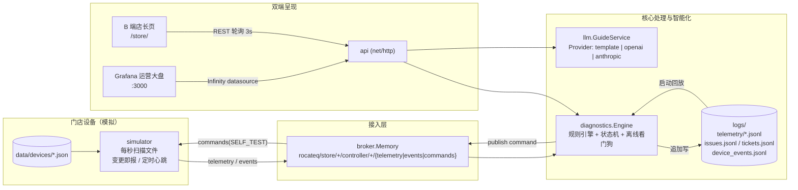
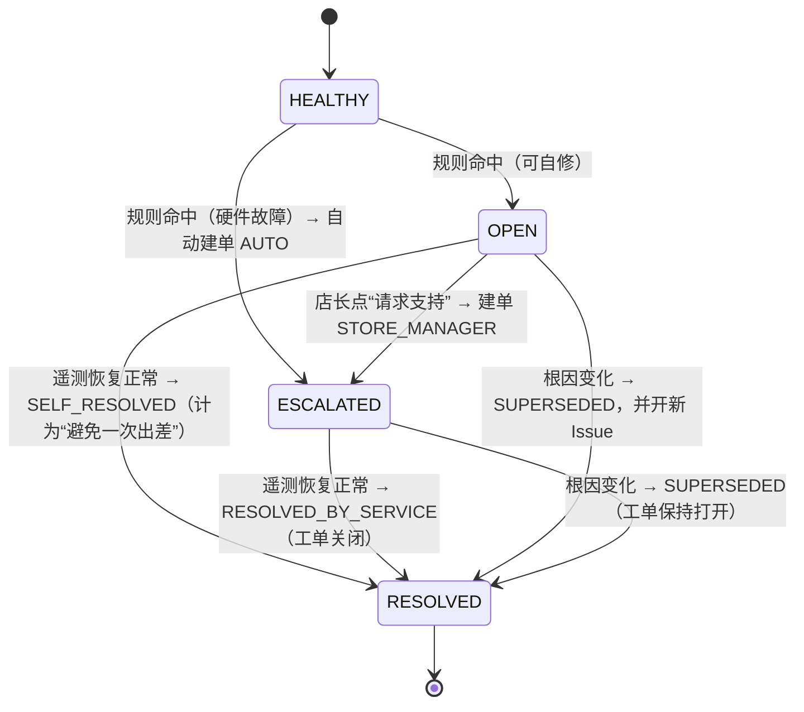
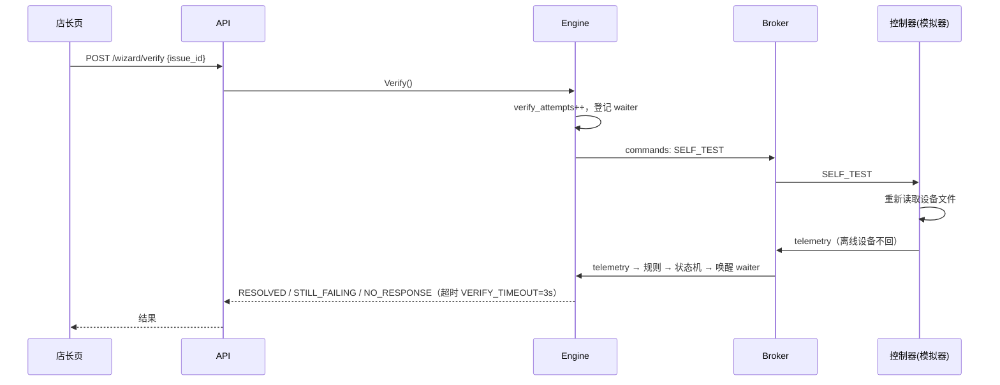

# Rocateq 远程排障 Dashboard Demo — 设计说明（v0.1）

> 面向：后端开发者 / 代码审核人  
> 关联文档：[technical_architecture_spec.md](technical_architecture_spec.md)（下称 *Spec*）§2 “需求一：远程故障诊断与门店自助排障平台”  
> 范围：只实现需求一的可运行 Demo；需求二（工时/报销 ERP）不在本次范围。

---

## 1. 目标与取舍

| 目标 | Demo 做法 | 生产做法（Spec） |
| :--- | :--- | :--- |
| 门店控制器上报遥测 | `data/devices/*.json`，**一个文件 = 一台控制器**，内置模拟器读文件并上报 | 真实 Rocateq Controller 走 MQTT |
| 接入层 (Ingestion) | 进程内存 Broker，MQTT 风格 topic + `+`/`#` 通配 | EMQX |
| 核心诊断引擎 | Go：规则引擎 + 每控制器状态机 | 同左（代码可直接沿用） |
| 时序/状态持久化 | `logs/` 目录下 JSONL 追加写，启动时回放 | PostgreSQL + TimescaleDB |
| LLM 多语言指引 | `Provider` 接口；内置 `template` 实现（en/nl/fr/de 离线模板），OpenAI / Anthropic 留桩 | GPT-4o / Claude / Gemini |
| B 端店长界面 | Go 内嵌的静态单页（无构建步骤） | PWA |
| 内部运营大盘 | Grafana 12 + Infinity 插件，直接读 Go 的 JSON API | Grafana + TimescaleDB SQL |

原则：**每个“被简化”的组件都藏在一个接口后面**，替换成生产组件时业务代码（`internal/diagnostics`）不用动。

后端只用 Go 标准库（Go 1.22+ 的 `net/http` 路由已支持 `GET /x/{id}`），**零第三方依赖**。理由：Demo 体量小，框架带来的收益抵不过依赖与学习成本；后续若接 EMQX 只需引入 `paho.mqtt.golang` 一个包。

---

## 2. 总体架构



单进程启动顺序（`cmd/rocadash/main.go`）：加载门店注册表 → 打开日志存储并回放 → 创建 Broker → 创建 LLM 服务 → 创建 Engine（回放 issue/ticket）→ 启动 Engine 订阅 → 启动模拟器 → 启动 HTTP。

---

## 3. 目录与模块划分

```
cmd/rocadash/            main：装配 + 生命周期（signal 优雅退出）
internal/
  config/                flag > 环境变量 > 默认值
  model/                 报文与领域类型（Telemetry, Finding, Issue, Ticket, Status…）
  broker/                Broker 接口、topic 工具、内存实现
  simulator/             文件驱动的控制器模拟器
  storage/               TelemetryStore / Journal 接口 + JSONL 文件实现
  diagnostics/           rules.go 规则 · engine.go 状态机/动作 · views.go 只读视图
  llm/                   Provider 接口 · prompt · template 实现 · 远程 provider 桩 · 缓存服务
  api/                   REST：店长端 + 运营大盘数据源
web/store/               店长页（HTML/CSS/JS，go:embed 打包进二进制）
data/stores.json         门店注册表（语言、坐标、控制器位置描述）
data/devices/*.json      模拟控制器
deploy/grafana/          datasource / dashboard provisioning + 大盘 JSON
docker-compose.yml       仅 Grafana
```

依赖方向（无环）：`api → diagnostics → {broker, storage, model}`，`api → llm`，`simulator → {broker, model}`。`diagnostics` 不依赖 `llm`：引擎只产出“根因”，“怎么跟店长说”由 API 层调用 LLM 完成——诊断逻辑和文案生成解耦，LLM 慢或挂掉不影响状态机。

---

## 4. 核心：诊断引擎

### 4.1 规则（`internal/diagnostics/rules.go`）

规则签名：`type Rule func(t *model.Telemetry, now time.Time) []model.Finding`。每条规则独立，`Evaluate` 汇总后按优先级排序，**第一条为主根因**。

| 优先级 | 根因码 | 触发条件 | 店长可自修 | 备件 |
| :-: | :--- | :--- | :-: | :--- |
| 0 | `GATEWAY_OFFLINE` | 看门狗：超过 `OFFLINE_TIMEOUT`（默认 30s）无遥测 | ✅ | — |
| 1 | `POWER_SUPPLY_ABNORMAL` | `power.status != NORMAL` 或 `voltage_mv < 10000` | ✅ | PSU-12V-5A |
| 2 | `LOOP_CABLE_DISCONNECTED` | 供电正常 且 某 loop `status=OPEN_CIRCUIT` 或阻抗 > 10kΩ | ✅ | — |
| 3 | `ANTENNA_TX_FAULT` | 某 antenna `status=FAULT` / `signal_tx_active=false` / 阻抗不在 30–80Ω | ❌ → 自动派单 | ANT-DRV-BOARD-V3, COAX-RG58-2M |

优先级设计：供电挂了会让所有 loop 看起来都断，所以先让店长查电源；`LoopRule` 在供电异常时直接不触发，避免误报。

Peripheral 类型按名称推断（`perimeter_loop_*` → loop，`*antenna*` → antenna，`*relay*` → relay），也可在报文里显式写 `type`。`port` 字段是对 Spec §2.3 报文的**扩展**，用于告诉店长“检查哪个插口”——**需要硬件团队确认固件能否上报**。

### 4.2 状态机（`internal/diagnostics/engine.go`）

每个控制器一个 `ctrlState`，至多一个“未关闭 Issue”。



要点：
- **同一根因持续命中不重复开单**；根因变了 → 旧 Issue `SUPERSEDED` + 新 Issue。
- **SUPERSEDED 不关工单**：例如天线坏了期间盒子又掉线，掉线只是把天线故障“盖住”了；恢复在线后天线故障重新出现，会**复用同一张未关闭的工单**而不是重复派单。
- 门店整体状态 = 其所有控制器中**最严重**的状态：`OFFLINE > SERVICE_REQUIRED > ESCALATED > ACTION_REQUIRED > UNKNOWN > HEALTHY`。
- 遥测身份以 **topic 为准**（覆盖 payload 里的 store_id/controller_id），对应生产中 EMQX 以设备证书绑定 topic 的 ACL。
- 注册表外的设备上报时会被自动登记为“未知门店”，在大盘上可见，不丢数据。

### 4.3 “重新验证”往返（Spec §2.6 #2）



`verify_attempts` 会写进工单（`wizard_attempts`），让工程师知道店长已经自查过几次。

### 4.4 并发模型

- Engine 用一把 `sync.Mutex` 保护全部状态；遥测处理、看门狗、API 读写都短持锁，规则计算和磁盘写遥测在锁外。2,000 店 × 每 30s 一帧 ≈ 67 msg/s，单锁足够；瓶颈出现前应先换 TimescaleDB。
- Broker 每个订阅一个带缓冲 channel（1024）+ 一个 goroutine，满了丢弃并告警（QoS0 语义）。
- 模拟器全部状态只在自己的 Run goroutine 中访问，命令通过 channel 投递进来，无锁。
- 所有视图方法返回**副本**，API 层不会持有引擎内部指针。

---

## 5. 持久化：日志文件方案

目录 `logs/`（可用 `-logs` / `LOG_DIR` 修改，已加入 `.gitignore`）：

| 文件 | 内容 | 写入时机 | 读取 |
| :--- | :--- | :--- | :--- |
| `telemetry/YYYY-MM-DD.jsonl` | `{received_at, telemetry}` 每帧一行，按 UTC 日期滚动 | 每收到一帧 | 启动时回放保留窗口（默认 6h）进内存环形缓冲；大盘查询只查内存 |
| `issues.jsonl` | `{at, event, issue}`，event ∈ opened / verify_attempt / escalated / resolved | 每次 Issue 状态变化（**全量快照**） | 启动回放，同 id 取最后一行 |
| `tickets.jsonl` | Ticket 全量快照（含门店全部控制器的遥测 snapshot） | 建单 / 关单 | 启动回放 |
| `device_events.jsonl` | 设备 events topic 原文 | 收到 event | 仅审计，不回放 |

设计说明：
- **事件溯源的简化版**：每行都是实体全量快照，回放就是“后写覆盖先写”，不需要合并逻辑。坏行（崩溃时写一半）被跳过。
- 重启后：未关闭的 Issue 重新挂回控制器；ID 序号从日志中最大值续上，不会重复。
- 接口在 `internal/storage`：`TelemetryStore{Append, Query, Close}`、`Journal{IssueEvent, Ticket, DeviceEvent, Replay, Close}`。上 TimescaleDB 时实现这两个接口即可；`Query` 届时直接下推 SQL `time_bucket`。
- 已知局限：查询窗口受内存保留期限制；单文件无压缩、无清理（Demo 可接受，生产交给数据库保留策略）。

---

## 6. LLM 模块

```go
type Provider interface {
    Name() string
    GenerateGuide(ctx context.Context, req GuideRequest) (*Guide, error)
}
```

- `GuideService` = Provider + **缓存**（key 为整个 `GuideRequest`：故障码、部件、位置、语言…）+ **超时** + **兜底**（远程失败自动退回 `template`，兜底结果不缓存，远程恢复后自动切回）。
- 同一故障在同一门店的指引基本不变，缓存命中率接近 100%，这是 Spec §4.3 中 LLM 成本能压到 €10–25/月的前提。
- `prompt.go`：`BuildGuidePrompt`（Spec §2.5 的 prompt，硬件故障时切换为“别动，工程师已出发”的 2 步话术）+ `ParseGuideJSON`（校验、容忍 ```json 代码块）。所有远程 Provider 共用，保证输出契约一致。
- `remote.go`：`OpenAI` / `Anthropic` 已有结构体与配置，**HTTP 调用处标了 TODO**，拿到 API key 后补约 30 行代码即可。
- 选择方式：`LLM_PROVIDER=template|openai|anthropic`，`LLM_API_KEY`，`LLM_MODEL`，`LLM_BASE_URL`。

---

## 7. API

### 7.1 店长端（与 Spec §2.6 对齐）

| 方法 | 路径 | 说明 |
| :--- | :--- | :--- |
| GET | `/api/v1/stores` | 门店下拉列表（Demo 用） |
| GET | `/api/v1/stores/{store_id}/diagnostics/wizard?lang=xx` | 状态 + 当前 Issue + LLM 指引。`lang` 缺省用门店偏好语言 |
| POST | `/api/v1/stores/{store_id}/diagnostics/wizard/verify` | body `{issue_id?, controller_id?}`，空 body = 验证当前 Issue |
| POST | `/api/v1/stores/{store_id}/tickets/escalate` | body `{issue_id?, note?}`，幂等：已有工单则返回原工单 |

与 Spec 的差异：wizard 响应中 `active_issue.wizard_data` 直接采用 Spec §2.5 的 LLM 标准 JSON（`title / status_color / estimated_fix_time / steps[]`），而不是 §2.6 里简化的 `{step, text}`，省一次转换；另外增加了 `controllers[]`、`state`、`ticket_id`、`verify_attempts` 字段。

### 7.2 运营大盘数据源（Grafana Infinity 读取）

| 路径 | 返回 |
| :--- | :--- |
| `/api/v1/ops/summary` | 单对象：各状态门店数、未关闭 Issue、工单数、自助解决数、避免出差次数、估算节省 € |
| `/api/v1/ops/stores` | 每店一行（含经纬度、`status_rank` 供地图着色），按严重度排序 |
| `/api/v1/ops/issues?state=open` | Issue 行；不带参数为全部历史 |
| `/api/v1/ops/tickets` | 工单行（含需携带备件） |
| `/api/v1/ops/root-causes` | 根因分布（不计 SUPERSEDED） |
| `/api/v1/ops/telemetry?metric=&from=&to=&step_ms=` | 长表 `{time, series, value}`；metric ∈ `voltage_mv, current_ma, temp_celsius, loop_impedance, antenna_impedance`；按 step 分桶取末值降采样 |

“避免出差”KPI 口径：`SELF_RESOLVED` 的 Issue 数 × `AVOIDED_TRIP_COST_EUR`（默认 €2,000，取 Spec §4.3 的 €1,500–3,000 中位）。**这个口径需要业务方确认**。

---

## 8. 前端

**B 端店长页**（`web/store/`，访问 `http://localhost:8080/store/`）
- 大红绿灯 + 一句话状态 → 3 步图文向导（可逐步勾选）→ “重新验证” / “请求支持” → 工单卡片（显示工程师会带的备件）→ 设备列表。
- 界面文案 en/nl/fr/de 四语（右上角可切换，默认按门店语言）；向导内容来自 LLM 模块。
- 纯 HTML/JS，每 3 秒轮询，无构建工具链，`go:embed` 进二进制，单文件部署。

**Grafana 运营大盘**（`http://localhost:3000`，匿名 Admin，首页即大盘）
- 第 1 行 KPI：健康门店 / 店长可自修 / 已派工程师 / 离线 / 避免出差次数 / 估算节省 €
- 门店地图（按状态着色）+ 门店状态表
- 供电电压曲线（10V 红线）+ 地感线圈阻抗曲线（对数轴，10kΩ 红线）
- 未关闭 Issue 表 + 根因分布 + 工单表 + Issue 历史
- 版本固定：Grafana `12.2.0` + Infinity `3.11.1`（Infinity 4.x 与 Grafana 11 不兼容，已踩坑）。

---

## 9. 配置项

| flag | 环境变量 | 默认 | 说明 |
| :--- | :--- | :--- | :--- |
| `-addr` | `ADDR` | `:8080` | |
| `-stores` | `STORES_FILE` | `data/stores.json` | |
| `-devices` | `DEVICES_DIR` | `data/devices` | |
| `-logs` | `LOG_DIR` | `logs` | |
| `-sim` | `SIMULATOR` | `true` | 关掉即“只等真实设备” |
| `-offline-timeout` | `OFFLINE_TIMEOUT` | `30s` | |
| `-verify-timeout` | `VERIFY_TIMEOUT` | `3s` | |
| `-retention` | `TELEMETRY_RETENTION` | `6h` | 内存时序窗口 |
| `-trip-cost` | `AVOIDED_TRIP_COST_EUR` | `2000` | |
| `-llm` | `LLM_PROVIDER` | `template` | |
| — | `LLM_API_KEY` / `LLM_MODEL` / `LLM_BASE_URL` | | |

---

## 10. 运行与演示

### 10.1 启动

```bash
# 终端 1：后端（含模拟器）
go run ./cmd/rocadash
# 终端 2：Grafana（首次会下载镜像和插件）
docker compose up -d
```

- 店长页：<http://localhost:8080/store/>
- 运营大盘：<http://localhost:3000>（打开即大盘；全屏展示加 `?kiosk`）
- 测试：`go test ./...`

重置演示：停服务 → 删除 `logs/` → 把 `data/devices/` 恢复成初始状态（建议先 commit，之后 `git checkout data/devices`）。

### 10.2 预置场景

| 门店 | 场景 | 初始状态 |
| :--- | :--- | :--- |
| NL-JUMBO-1042 Rotterdam (nl) | 地感线圈插头松动（Spec 原例） | 🔴 店长可自修 |
| FR-CARREFOUR-7712 Paris (fr) | 供电 9.4V 欠压 | 🔴 店长可自修 |
| DE-REWE-3301 Berlin (de) | 天线发射级损坏 | 🟠 自动派单 |
| BE-DELHAIZE-0551 Brussels (fr) | 盒子不在线（`sim.online=false`） | 🔴 30s 后离线 |
| NL-AH-2210 Amsterdam (nl) | 正常 | 🟢 |
| GB-TESCO-8812 London (en) | 正常，2 台控制器 | 🟢 |

### 10.3 建议演示脚本（约 5 分钟）

1. **先看大盘**（Grafana）：“这是 Rocateq 总部视角，6 家店，哪家有问题、什么问题、一眼可见。” 指出 Carrefour 电压曲线跌破 10V 红线、Jumbo 线圈阻抗飙到 100kΩ。
2. **切到店长页 Jumbo**（荷兰语）：“店长看到的不是错误码，是荷兰语三步向导，告诉他去 *kassa 1 下面* 找 *黄色 J2 插头*。”
3. **先不修，点“Opnieuw testen”** → 返回“仍有问题”。说明：系统真的下发了自检命令并等待设备回包。
4. **“插回电线”**：在编辑器里打开 `data/devices/NL-JUMBO-1042_CTRL-UNIT-01.json`，把 `perimeter_loop_1` 改为
   `"impedance_ohms": 6, "status": "CONNECTED", "signal_tx_active": true`，保存。
   （“这个文件就代表现场硬件，改文件 = 店长插紧了插头。”）
5. **再点验证** → 绿灯 ✅。回到大盘：“避免出差 +1，估算节省 +€2,000”，Issue 历史里出现 `Self-resolved (trip avoided)`。
6. **REWE（德语/切英语）**：硬件故障不让店长折腾，已**自动建单**，工单上写明工程师要带 `ANT-DRV-BOARD-V3`——“就算必须出差，也是一次带对备件的精准出差”。
7. **Delhaize**：把 `"online": false` 改为 `true` 保存 → 几秒内从离线恢复绿灯（演示离线检测）。
8. 可选：切语言（右上角 EN/NL/FR/DE）；或把 Carrefour 的 `voltage_mv` 改成 `12100`、`status` 改成 `NORMAL` 演示供电恢复。
9. **收尾讲架构**：每个简化组件都是接口——内存 Broker → EMQX，日志文件 → TimescaleDB，模板 → GPT/Claude，诊断引擎代码原样上生产。

其他可现场制造的故障：把任何健康设备的 `voltage_mv` 改成 `9000`（供电异常），或把 `checkout_antenna_2.signal_tx_active` 改成 `false`（硬件故障→自动派单），或删掉一个设备文件（30s 后离线）。

---

## 11. 已知局限 / 生产化路径

| 项 | 现状 | 生产化 |
| :--- | :--- | :--- |
| Broker | 进程内，进程重启消息丢失 | EMQX + `paho.mqtt` 实现 `broker.Broker`；遥测 QoS0、events QoS1、shared subscription 支持多实例 |
| 存储 | JSONL + 内存窗口 | TimescaleDB 实现 `TelemetryStore`（hypertable + `time_bucket`），Postgres 实现 `Journal`；Grafana 改用 PG datasource |
| 多实例 | 状态在单进程内存 | 状态外置（PG）或按 store_id 分片订阅 |
| 鉴权 | 无（店长页、ops API 均开放） | 店长端门店级 token / magic link；ops API 内网 + Grafana SSO |
| LLM | 模板 | 补 `remote.go` 的 HTTP 调用；建议在 Issue 创建时预生成并持久化指引 |
| 规则 | 硬编码阈值 | 阈值按控制器型号配置化；规则命中写入 Issue 便于回溯 |
| 工单 | 只记录、不通知 | 对接邮件/Slack/现有工单系统；接需求二的出差流程 |
| 地图底图 | 依赖外网 CARTO 瓦片，离线环境只显示点位 | 内网瓦片服务或换表格展示 |

## 12. 请审核人重点关注

1. 根因优先级与“可自修”判定是否符合现场经验（§4.1）——尤其是 `GATEWAY_OFFLINE` 是否该让店长自查。
2. 状态机中 SUPERSEDED 不关工单、复用工单的策略（§4.2）。
3. `port` 字段等报文扩展是否能由固件提供（§4.1）。
4. “避免出差”KPI 口径（§7.2）。
5. 存储接口的抽象粒度是否足够平滑迁移到 TimescaleDB（§5）。
