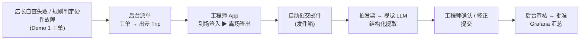
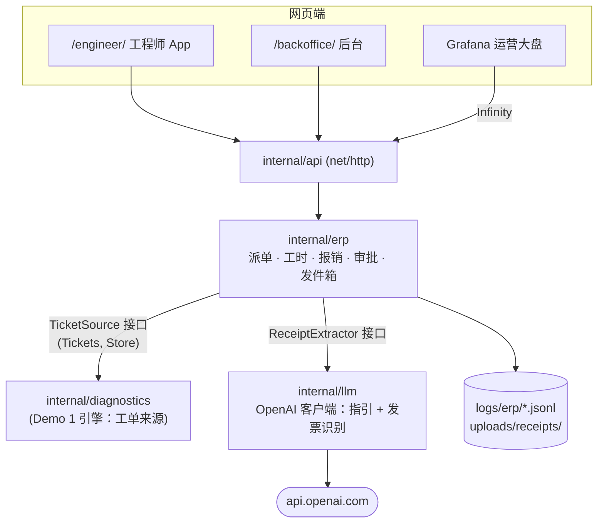
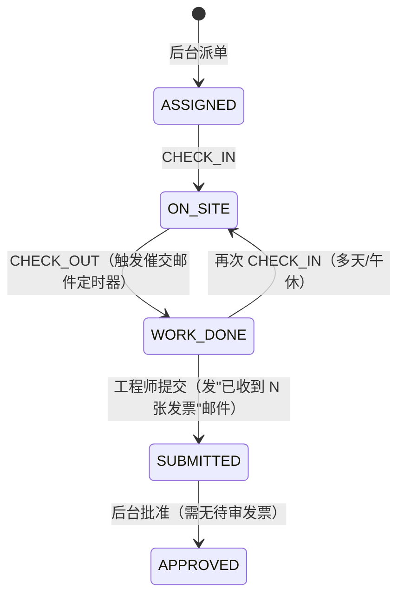
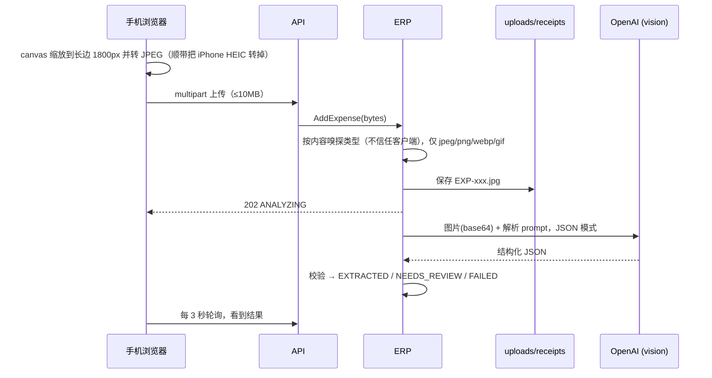
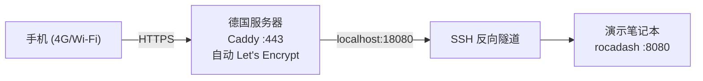

# Rocateq 出差工时与智能报销 Demo — 设计说明（v0.1）

> 面向：后端开发者 / 代码审核人；第 10 节（不做的部分）和第 11 节（讨论项）也面向业务方  
> 关联文档：[technical_architecture_spec.md](technical_architecture_spec.md)（下称 *Spec*）§0、§3；[dashboard_demo_design.md](dashboard_demo_design.md)（需求一 Demo，下称 *Demo 1*）  
> 范围：Spec 需求二的可运行 Demo，并与 Demo 1 串成 Spec §0 的完整故事线。

---

## 1. 目标与故事线



| Spec 中的设计 | Demo 做法 | 说明 |
| :--- | :--- | :--- |
| 工程师移动端 PWA | `/engineer/` 手机优先网页，可"添加到主屏幕" | Spec 本来就选 PWA，这就是目标形态，不是替代品 |
| 打卡 API `POST /engineers/timesheets/punch` | 同路径、同 payload | 加了 GPS 与门店距离校验（只告警不拦截） |
| 邮件 + n8n 收发票 | App 内拍照上传；邮件改为"发件箱"页面 | 见 §6 |
| 多模态 LLM 发票解析 | **真实调用** OpenAI `gpt-5.4-mini`（视觉） | 无 key 时转人工录入，**绝不伪造结果** |
| 出差汇总 `GET /trips/{id}/summary` | 同路径，字段兼容并扩展 | `total_travel_hours` 暂为 `null`，见 §11 |
| 财务查看 / 审批 | `/backoffice/` + Grafana 新增一行面板 | |
| 对接 Exact / Twinfield | **不做** | 见 §10 |

---

## 2. 架构与模块

与 Demo 1 同一仓库、同一进程，新增模块均挂在已有接口上：



| 文件 | 职责 |
| :--- | :--- |
| `internal/erp/types.go` | Trip / Punch / Expense / Email 及读模型 |
| `internal/erp/service.go` | 全部业务动作 + 状态机 + 回放 + 催交定时器 |
| `internal/erp/calc.go` | 工时计算、GPS 距离、费用汇总、发票时间包络 |
| `internal/llm/openai.go` | 纯 `net/http` 的 Chat Completions 客户端（无 SDK） |
| `internal/llm/receipt.go` | `ReceiptExtractor` 接口、发票 prompt、结果校验 |
| `internal/api/erp.go` | ERP REST + Grafana 数据源 |
| `web/engineer/`, `web/backoffice/` | 两个前端（纯 HTML/JS，`go:embed`） |
| `tools/receipts/gen_receipts.py` | 样例发票生成器（只生成图片，见 §5.4） |

依赖方向：`erp → diagnostics(只读接口) / llm / storage`。ERP 只通过 `TicketSource` 接口读取工单和门店，诊断引擎完全不知道 ERP 的存在。

---

## 3. 状态机

### 3.1 Trip



- 一个工单只能派一次（重复派单返回 409）。
- 签入/签出必须交替；提交后不能再打卡；批准后不能再改发票。
- **打卡时间以服务器时间为准**，客户端时间只存档（防止改手机时间）。
- GPS 与门店距离 > 1 km 记为告警，不拦截：室内 GPS 常常不准，拦截会误伤工程师。没有 GPS 也允许打卡（权限被拒、或 HTTP 下浏览器禁用定位）。

### 3.2 Expense（发票）

| 状态 | 含义 | 阻塞审批 |
| :--- | :--- | :-: |
| `ANALYZING` | 已上传，LLM 读取中 | ✅ |
| `EXTRACTED` | LLM 置信度 ≥ 0.8 且未自标存疑 → 自动接受 | |
| `NEEDS_REVIEW` | LLM 置信度 < 0.8 或自标 `flag_manual_review` | ✅ |
| `FAILED` | 无视觉模型 / 调用失败 → 人工录入 | ✅ |
| `CONFIRMED` | 工程师确认或修正过 | |

设计原则是"AI 填、人确认，但只在需要时才让人确认"。高置信度结果不打扰工程师，符合 Spec "零行政负担"。`extracted`（模型原始输出）**永不修改**，`final` 才是计入金额的值，所以审计时能看到"AI 读到什么 vs 人最后批的是什么"。

---

## 4. 工时规则（v1）

**v1 规则（已与业务确认）：现场工时 = 每对 CHECK_IN → CHECK_OUT 的时长之和。** 未签出时按"到现在为止"实时计算并标记 `on_site_now`。

差旅工时（`total_travel_hours`）v1 **不计算，返回 `null`**。但系统已把后续校准需要的数据准备好，见 §11 讨论项 1。

---

## 5. 发票识别流水线



### 5.1 输出结构

兼容 Spec §3.3，并扩展：
- `transaction_time`：发票上印的本地时间。
- `review_reason`：模型说明为什么存疑。
- `travel_segment {from, to, departure_time, arrival_time}`：机票、火车票、出租车填写。

这些扩展是为 §11 的工时校准准备的。

### 5.2 Prompt 要点（`internal/llm/receipt.go`）

- 只读印出来的内容，缺什么不猜；欧洲数字格式统一（`1.234,50 → 1234.50`）。
- 类别限定为 Spec 的 6 类，停车归 `OTHER`。模型给出非法类别时服务端兜底为 `OTHER`。
- 金额或日期读不出 → 必须 `flag_manual_review=true`。服务端也会再查一遍，模型漏标同样拦住。
- `line_items_summary` 不得包含姓名、地址、卡号（GDPR 最小化）。

### 5.3 实测（2026-10-12，`gpt-5.4-mini`，7 张样例发票）

| 发票 | 结果 | 金额 / 增值税 | 置信度 | 耗时 |
| :--- | :--- | :--- | :-: | :-: |
| 史基浦机场早餐（荷兰语） | 自动接受 | €7.40 / €0.61 | 0.95 | 3.5s |
| 去程机票 AMS→BER | 自动接受，航段时间正确 | €189.00 / €0 | 0.97 | 3.7s |
| 柏林出租车（德语） | 自动接受，航段 09:02–09:41 | €38.50 / €2.52 | 0.97 | 3.5s |
| 晚餐（德语） | 自动接受 | €30.80 / €4.92 | 0.97 | 3.2s |
| 酒店发票（7%/19% 混合税率） | 自动接受，增值税合计正确 | €153.45 / €11.31 | 0.98 | 3.1s |
| **褪色停车票（刻意模糊）** | **NEEDS_REVIEW**，理由：日期只有两位年份 | €24.00 / €3.83 | 0.74 | 3.3s |
| 返程机票 BER→AMS | 自动接受，航段时间正确 | €176.00 / €0 | 0.98 | 3.3s |

注意：机票的 `transaction_date` 是**出票/付款日**（出发前 2 天）而非飞行日。这是正确读法，飞行时间在 `travel_segment` 里。

### 5.4 样例发票与"不作弊"原则

`tools/receipts/gen_receipts.py` 用 Pillow 生成 7 张"手机拍照风格"的发票：带旋转、阴影、光照不均和噪点。商户全部虚构，每张底部印有 "DEMO" 字样。

**生成器只输出图片，不输出任何"标准答案"文件。** 应用里也没有任何读取预设结果的代码路径。样例发票与真实照片走完全相同的流程（`POST /trips/{id}/expenses/sample` 只是从服务器目录读取图片字节，然后调用同一个 `AddExpense`）。没有视觉模型时状态是 `FAILED`（人工录入），而不是假数据。

重新生成（日期默认今天）：`python tools/receipts/gen_receipts.py --date 2026-10-20`

---

## 6. 邮件与 n8n 的替代

| Spec 节点 | Demo |
| :--- | :--- |
| ① 周五 16:00 Cron 催交 | 签出后 `REMINDER_DELAY`（默认 20s）发一封催交邮件；进程重启后自动补排 |
| ② IMAP 监听回信 | 不做：改为 App 内拍照（体验更直接） |
| ③ 并发调用 LLM Vision | 同左（Go goroutine，每张发票一次调用） |
| ④ 回执邮件 | 提交时发"已收到 N 张发票，总计 €X"；批准时发"已批准" |

所有邮件写入 `logs/erp/outbox.jsonl`，在 `/backoffice/` 的 Outbox 区展示；工程师 App 顶部也会显示该行程的最新邮件横幅。邮件里的链接使用 `PUBLIC_BASE_URL`，手机演示时就是 HTTPS 地址。生产环境只需要把 `sendLocked` 换成 SMTP 或 n8n webhook。

---

## 7. API

| 方法 | 路径 | 说明 |
| :--- | :--- | :--- |
| GET | `/api/v1/engineers` | 工程师列表（Demo 身份选择） |
| GET | `/api/v1/dispatch/queue` | 未派单的 OPEN 工单 |
| POST | `/api/v1/trips` | `{ticket_id, engineer_id}` 派单 → 201 Trip；重复 409 |
| GET | `/api/v1/trips?engineer_id=` | 行程列表（含汇总） |
| GET | `/api/v1/trips/{id}` | 行程详情：trip + summary + expenses |
| GET | `/api/v1/trips/{id}/summary` | Spec §3.4 #2 |
| POST | `/api/v1/engineers/timesheets/punch` | Spec §3.4 #1 payload；`geo_lat/geo_lng` 可空 |
| POST | `/api/v1/trips/{id}/submit` | `{engineer_id}` |
| POST | `/api/v1/trips/{id}/approve` | `{approver}`；有待审发票 → 409 |
| POST | `/api/v1/trips/{id}/expenses` | multipart `file`, `engineer_id` → 202 |
| POST | `/api/v1/trips/{id}/expenses/sample` | `{name, engineer_id}`，演示用 |
| GET | `/api/v1/expenses/{id}/image` | 原图（`nosniff`） |
| POST | `/api/v1/expenses/{id}/confirm` | `{engineer_id, receipt?}`：空 = 原样确认，带 receipt = 修正 |
| POST | `/api/v1/expenses/{id}/retry` | 重新让 LLM 读取 |
| GET | `/api/v1/erp/outbox` | 发件箱 |
| GET | `/api/v1/erp/sample-receipts[/{name}]` | 样例发票列表 / 图片（白名单，防路径穿越） |
| GET | `/api/v1/ops/erp/{summary,trips,expense-categories}` | Grafana 数据源 |

错误码：404 不存在 / 400 参数错误或类型不支持 / 409 状态不允许。

---

## 8. 持久化

延续 Demo 1 的做法：每次变更都追加一行实体全量快照，启动时回放（后写覆盖先写）。

| 文件 | 内容 |
| :--- | :--- |
| `logs/erp/trips.jsonl` | Trip 快照（含全部打卡记录） |
| `logs/erp/expenses.jsonl` | Expense 快照（含 LLM 原始输出与最终值） |
| `logs/erp/outbox.jsonl` | 已发邮件 |
| `uploads/receipts/EXP-*.jpg` | 发票原图（已 gitignore：含个人信息） |

重启时：
- 签出后还没发的催交邮件会重新排期。
- 停在 `ANALYZING` 的发票会自动重新识别。
- ID 序号会接着用，不会重复。

通用实现：`storage.SnapshotLog[T]`（泛型），未来换 Postgres 只需要替换这一层。

---

## 9. 配置与安全

| 变量 | 默认 | 说明 |
| :--- | :--- | :--- |
| `OPENAI_API_KEY` | — | 从根目录 `.env` 读取（`.gitignore` 已排除 `.env` 与 `.env.*`；示例见 `.env.example`） |
| `LLM_PROVIDER` | `auto` | `auto` = 有 key 用 openai，否则 template（指引）/ 人工录入（发票） |
| `LLM_MODEL` | `gpt-5.4-mini` | 同时用于排障指引和发票识别 |
| `LLM_TIMEOUT` | `60s` | |
| `PUBLIC_BASE_URL` | `http://localhost:8080` | 邮件中的链接 |
| `REMINDER_DELAY` | `20s` | 生产应为傍晚定时任务 |
| `ENGINEERS_FILE` / `UPLOAD_DIR` / `SAMPLE_RECEIPTS_DIR` | `data/engineers.json` / `uploads` / `data/sample_receipts` | |

- `.env` 由内置的极简加载器读取。真实环境变量优先，key 不会写进日志。key 只放在 `Authorization` 头里发往 `api.openai.com`。
- 上传文件按内容嗅探类型，限 10MB，文件名由服务端生成；读样例发票走白名单。
- **GDPR**：发票照片（可能含姓名、卡号后四位）会发送给 OpenAI。生产环境需要：签数据处理协议（DPA）、开启零数据保留、优先选 EU 数据驻留；或者先在端侧/服务端打码再发送。见 §11 讨论项 4。

---

## 10. 本期不做（Out of scope）

| 不做的内容 | 原因 | 后续路径 |
| :--- | :--- | :--- |
| 对接 Exact / Twinfield 等财务软件 | 需要客户方账号与科目映射，Demo 不涉及 | 先出 CSV 导出，再做 API 同步；审批后触发 |
| 真实登录与权限 | Demo 用下拉框选身份 | 公司 SSO（Microsoft 365）+ 角色：工程师 / 审批人 / 财务 |
| 邮件收件（IMAP）与 n8n 工作流 | 演示稳定性优先，App 内拍照已覆盖核心体验 | n8n 监听回信 → 调用同一个 `AddExpense` 接口 |
| 真实发信（SMTP） | 不向外发邮件；发件箱页面可见 | 替换 `sendLocked` |
| 多币种与汇率 | 已确认 v1 全部按欧元计 | 接 ECB 每日汇率，按交易日折算；保留原币金额 |
| 差旅工时计算 / 加班 / 周末系数 | 规则未定，v1 只计签入–签出 | 见 §11 讨论项 1 |
| 多级审批、驳回、退回修改 | 单人批准足够演示 | 增加 `REJECTED` 状态与退回原因 |
| 每日补贴（per diem）、里程报销 | Spec 未提 | 按国家标准表自动计算 |
| 离线打卡（无网络时排队） | 需要 Service Worker 后台同步 | PWA Service Worker + IndexedDB 队列 |
| 原生 App（iOS/Android） | PWA 已能用相机、定位、主屏图标 | 只有需要后台定位或推送时才考虑 |
| 发票防重复 / 防篡改检测 | 需要指纹与规则库 | 图片哈希 + （商户、日期、金额）三元组去重 |
| 人员排班 / 派单优化 | Demo 手动指派 | 按技能、位置、备件库存推荐 |

---

## 11. 讨论项（需要业务方拍板）

1. **工时校准（发票时间包络）**：两张往返机票基本能框出整趟出差的总包络。系统已经做到：
   - 每张发票提取时间和航段；
   - 汇总里给出 `receipt_envelope`（最早 → 最晚，跨度多少小时），后台与现场工时并排展示。

   样例数据：包络 36.7h（06:25 早餐 → 次日 19:05 落地）。待定：
   - 差旅工时怎么由包络推出：全额？扣夜间？乘系数？
   - 签入签出与包络冲突时以谁为准？
   - 要不要让 LLM 给出"建议工时 + 理由"，由审批人参考？（技术上现成：把行程的打卡记录和发票摘要一起交给 LLM 即可。）
2. **自动接受阈值**：目前置信度 ≥ 0.8 自动接受。财务能接受多大比例不经人工？要不要对大额（如 > €500）强制人工？
3. **GPS 规则**：目前距离门店 > 1 km 只告警。是否需要更严格（例如签入必须在 300 m 内，否则需要备注）？
4. **发票图片隐私**：发给 OpenAI 前是否需要打码？用哪家、哪个数据区域？
5. **催交时机**：每天傍晚？行程结束当天？还是签出后 N 小时？

---

## 12. 运行与演示

### 12.1 启动

```bash
go run ./cmd/rocadash        # 读取 .env；日志中 llm_receipts=openai:gpt-5.4-mini 表示视觉模型已就绪
docker compose up -d         # Grafana（大盘最下方新增 "Field service" 一行）
```

- 工程师 App：<http://localhost:8080/engineer/>
- 后台：<http://localhost:8080/backoffice/>
- 店长页 / 大盘：同 Demo 1

重置（脚本会先停掉 rocadash，否则内存里的状态会被写回去）：

```powershell
powershell -ExecutionPolicy Bypass -File tools/reset_demo.ps1            # 全部重置：两个 demo 都回到初始状态
powershell -ExecutionPolicy Bypass -File tools/reset_demo.ps1 -ErpOnly   # 只重置出差/发票/邮件；REWE 工单保留，可直接从派单重演
```

bash 下用 `sh tools/reset_demo.sh [--erp-only]`。

### 12.2 串联演示脚本（约 8 分钟，接在 Demo 1 之后）

1. **（Demo 1）** REWE 天线故障 → 规则引擎自动建单，工单上写明备件。
2. **后台 `/backoffice/`**：派单队列里出现这张工单，标明来源是"规则引擎"，店长自查次数 0。选择 Mark → Dispatch。
3. **工程师 App（手机）**：Mark 看到新行程 Berlin，要带 `ANT-DRV-BOARD-V3`。点"Arrived on site"：拿到 GPS，显示离门店距离，计时开始。
4. **"修好硬件"**：编辑 `data/devices/DE-REWE-3301_CTRL-UNIT-01.json`，把 `checkout_antenna_2.signal_tx_active` 改为 `true`。店长页变绿，大盘记为"Resolved by service"，工单自动关闭。
5. **App 点"Leave site"**：现场工时记下，20 秒后 App 顶部出现催交邮件横幅（后台 Outbox 也能看到）。
6. **拍发票**：手机对着屏幕或打印出来的样例发票拍照，或点 🧾 Sample 选样例图片。约 3 秒后出结果：商户、金额、增值税、类别、航段。重点展示德语酒店发票里混合税率的增值税合计。
7. **褪色停车票**：显示 "Please check" 和原因，工程师点 "Looks right" 或修改金额。
8. **提交** → 后台：工时、费用、分类、发票时间包络 36.7h vs 现场工时，以及讨论项提示。待审为 0 时 Approve 可点 → 批准邮件。
9. **Grafana**：大盘底部 Field service 行汇总行程、工时、费用、AI 自动识别比例。
10. **收尾讲架构**：同一个 Go 进程里两个模块，通过接口解耦；收件箱、财务对接、汇率在 §10 有明确路径；§11 的讨论项抛给 Derrick。

---

## 13. 手机演示：HTTPS 方案

浏览器只在 HTTPS（或 localhost）下允许网页使用**定位**和完整的**相机**能力，所以手机演示需要一个 HTTPS 地址。推荐方案 A。

### 方案 A（已采用）：德国公网服务器做 HTTPS 入口，反向隧道回到笔记本



- 服务继续跑在笔记本上：现场改设备文件、看日志都方便；服务器只做 HTTPS 入口。
- 没有域名也行：用 `demo.<服务器IP>.sslip.io` 这类通配 DNS 就能申请 Let's Encrypt 证书。
- 步骤：
  1. 服务器安装 Caddy，配置 `demo.<域名> { reverse_proxy localhost:18080 }`。
  2. 笔记本执行 `ssh -N -R 18080:localhost:8080 <user>@<server>`。
  3. 启动时设置 `PUBLIC_BASE_URL=https://demo.<域名>`。
- 安全：演示期间加 Caddy basic auth，或只在演示时开隧道。

### 方案 B（最快、零服务器）：Cloudflare Quick Tunnel

`cloudflared tunnel --url http://localhost:8080` 会直接给出一个 `https://xxx.trycloudflare.com` 地址。缺点：每次地址都不同，依赖第三方，网络环境不稳时可能连不上。适合临时彩排。

### 方案 C：整套部署到服务器

用 Docker 部署到德国服务器，手机和电脑都访问服务器。最稳定，但现场"改设备文件"要 SSH 上去改。适合长期挂着给别人看。

### 已落地：方案 A（2026-10-12 配置完成并验证）

| 项 | 值 |
| :--- | :--- |
| 演示地址 | **https://rocateq-demo.2-28-105-58.sslip.io**（`/engineer/`、`/store/`、`/backoffice/`） |
| 登录 | 用户名和密码见本地 `.env` 的 `DEMO_BASIC_AUTH_USER` / `DEMO_BASIC_AUTH_PASSWORD`（不进 git；服务器上只存 bcrypt 哈希） |
| 服务器 | `2.28.105.58`（Hetzner，Ubuntu 24.04），Caddy 2.6.2（Ubuntu 官方源），证书自动续期 |
| 配置 | `/etc/caddy/Caddyfile`，模板在仓库 `deploy/caddy/Caddyfile`；原默认配置备份在 `/etc/caddy/Caddyfile.orig` |
| 隧道端口 | 服务器 `127.0.0.1:18080`，只绑定本机，外网不可直连（已验证） |
| 隧道未连接时 | 显示 "Rocateq demo is offline" 页面（503） |
| 访问日志 | `/var/log/caddy/rocateq-demo.log` |

已验证：无密码或密码错误返回 401；HTTP 自动跳转 HTTPS；隧道连通后各页面 200（往返约 70–90 ms）；通过 HTTPS 上传 multipart 照片后，视觉 LLM 识别正确。

#### 每次手机演示

```powershell
go run ./cmd/rocadash -tunnel     # 启动服务并同时打开隧道
```

约 2 秒后日志出现 `tunnel up — demo reachable url=https://…/engineer/`，说明手机已经能访问。

- 隧道由 `internal/tunnel` 调用系统自带的 `ssh -N -R 127.0.0.1:18080:localhost:8080 2.28.105.58` 建立：断线按退避自动重连；服务退出（Ctrl+C）时隧道一起关闭；不带 `-tunnel` 时完全不碰网络。
- 想默认开启，可在 `.env` 加 `TUNNEL=true`；服务器和端口可用 `-tunnel-server` / `-tunnel-port` 修改。
- 也可以不用开关，单独开隧道：`powershell -ExecutionPolicy Bypass -File tools/tunnel.ps1`（服务照常用 `go run ./cmd/rocadash` 启动）。
- 同一时间只能有一条隧道。如果日志提示 "server port already in use"，说明另一台机器或残留的 ssh 还连着。`tools/reset_demo.ps1` 会关掉本机残留的那条（只按端口映射匹配，不会动你其他的 SSH 会话）。

手机打开 `https://rocateq-demo.2-28-105-58.sslip.io/engineer/`，输入一次密码。浏览器询问定位权限时选"允许"；iOS Safari 可以"添加到主屏幕"，作为 App 打开。

演示结束后关掉窗口 2 即可，地址会显示 offline 页面。

#### 维护

- **换密码**：改 `.env` 中的 `DEMO_BASIC_AUTH_PASSWORD`，然后执行
  `grep '^DEMO_BASIC_AUTH_PASSWORD=' .env | cut -d= -f2- | tr -d '

' | ssh 2.28.105.58 'read -r p; caddy hash-password --plaintext "$p" > /root/.rocateq-demo-hash'`，
  再在服务器上用新哈希替换 `/etc/caddy/Caddyfile` 中 `demo` 后面的值，执行 `systemctl reload caddy`。
- **临时关闭对外地址**：`ssh 2.28.105.58 systemctl stop caddy`（再次开启用 `start`）。
- **彻底移除**：`ssh 2.28.105.58 'systemctl disable --now caddy && apt-get remove -y caddy && rm -f /root/.rocateq-demo-hash'`。
- **注意**：隧道开着时，任何拿到地址和密码的人都会消耗你的 OpenAI 额度，演示结束后记得关掉隧道。
