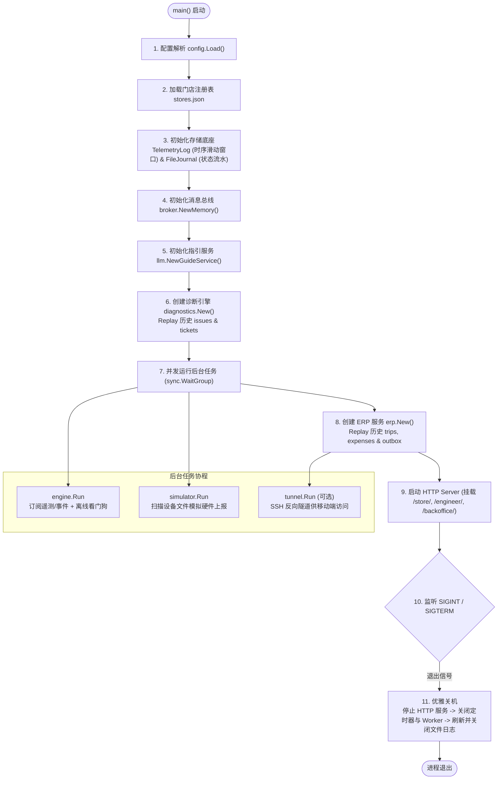
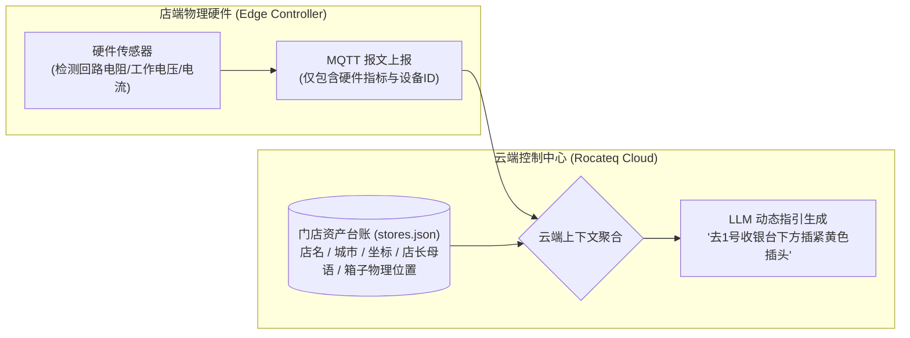
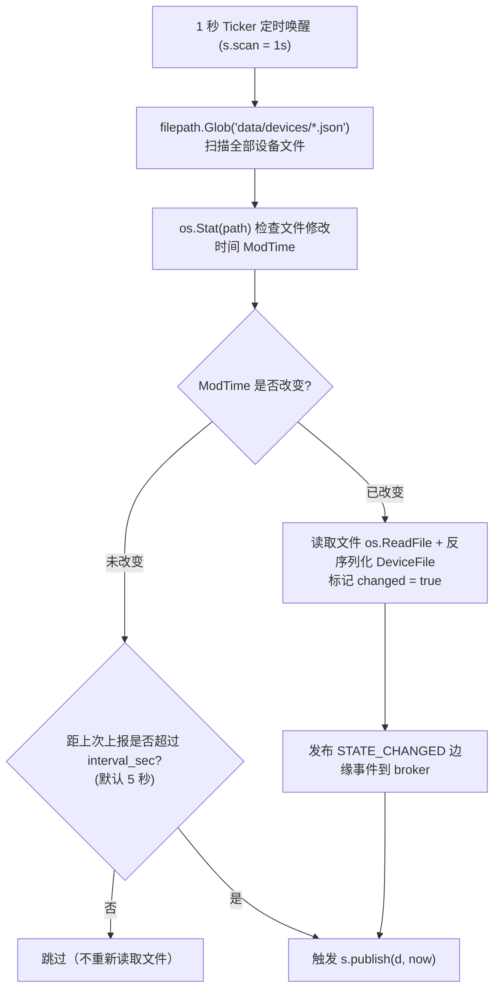
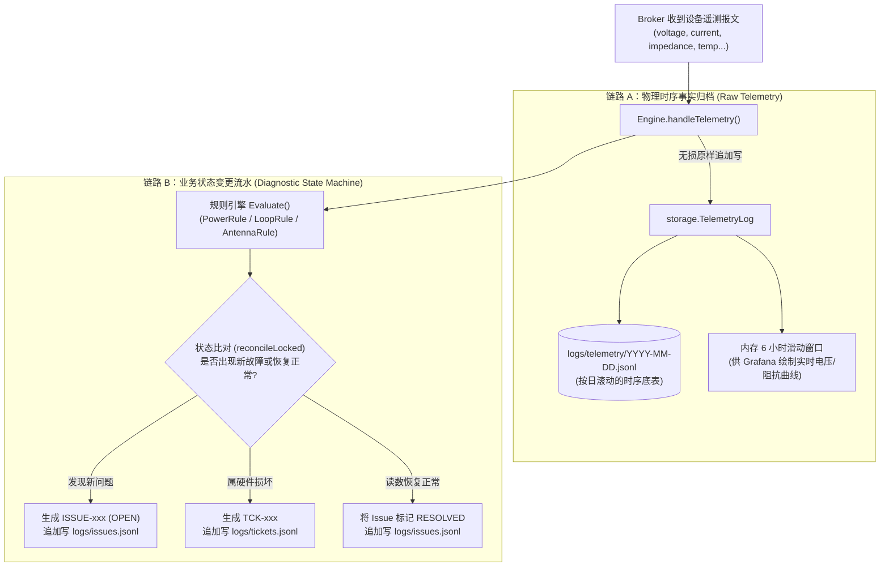
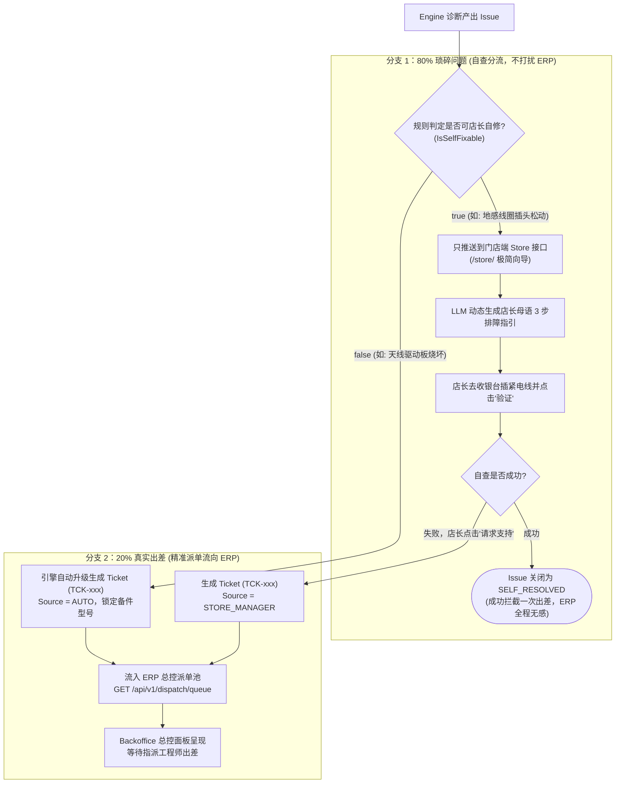
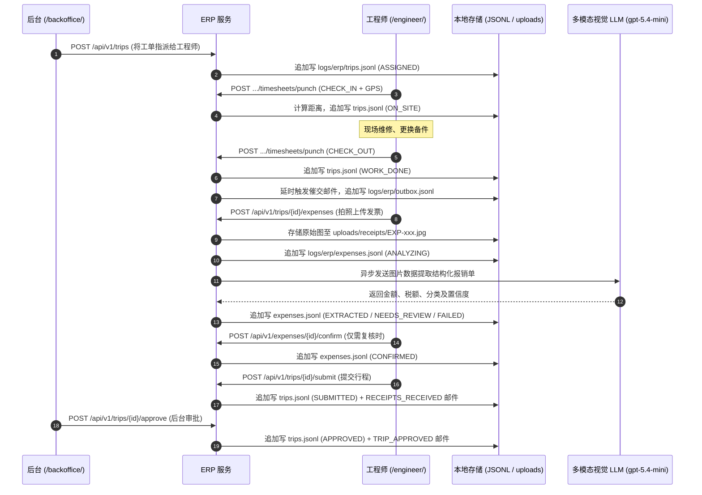

# Rocateq 业务流水线与架构设计手册
# System Workflow & Design Manual

> **版本**：v1.1.0 | **日期**：2026-10-12  
> **适用对象**：后端开发、系统架构、售后运维与商业管理团队  
> **关联代码**：[`cmd/rocadash/main.go`](../cmd/rocadash/main.go) | **文档关联**：[`technical_architecture_spec.md`](technical_architecture_spec.md) · 英文版：[`system_workflow_design_manual_en.md`](system_workflow_design_manual_en.md)

---

## 目录
1. [系统总流程与生命周期架构（main.go）](#1-系统总流程与生命周期架构maingo)
2. [流水线 A：远程故障诊断与门店排障（Dashboard 核心设计）](#2-流水线-a远程故障诊断与门店排障dashboard-核心设计)
   - 2.1 [核心机制一：边缘设备模拟与上报（Simulator & Ingestion Deep Dive）](#21-核心机制一边缘设备模拟与上报simulator--ingestion-deep-dive)
     - 2.1.1 设备实体镜像（`devices/*.json`）vs 云端资产台账（`stores.json`）
     - 2.1.2 模拟器单协程无锁 Actor 模型与 `*device` 指针原地覆写机制
     - 2.1.3 Jitter 传感器加噪与纯网络字节流隔离
   - 2.2 [核心机制二：时序事实与业务状态的双路分流模型（Dual-pipeline Architecture）](#22-核心机制二时序事实与业务状态的双路分流模型dual-pipeline-architecture)
     - 2.2.1 存储落盘位置与数据格式
     - 2.2.2 Grafana 与后端交互的真实本质
   - 2.3 [核心机制三：Issue 与 Ticket 的分流准入控制（The Core Dispatch Filter）](#23-核心机制三issue-与-ticket-的分流准入控制the-core-dispatch-filter)
     - 2.3.1 80% 门店自查闭环 vs 20% ERP 派工准入
     - 2.3.2 架构接口隔离：为什么 ERP 绝不直接碰 `Issues`
   - 2.4 [真实业务场景示例（Jumbo 门店地感线圈自修闭环）](#24-真实业务场景示例jumbo-门店地感线圈自修闭环)
3. [流水线 B：内部出差工时与智能报销（ERP）](#3-流水线-b内部出差工时与智能报销erp)
   - 3.1 [事件与请求流向](#31-事件与请求流向)
   - 3.2 [存储落盘位置与数据格式](#32-存储落盘位置与数据格式)
   - 3.3 [真实业务场景示例（REWE 柏林天线更换与差旅报销）](#33-真实业务场景示例rewe-柏林天线更换与差旅报销)

---

## 1. 系统总流程与生命周期架构（main.go）

系统的核心驱动入口位于 [`cmd/rocadash/main.go`](../cmd/rocadash/main.go)。系统采用**单进程模块化单体（Modular Monolith）**架构，以极低资源开销整合了**设备模拟、消息接入、规则诊断、LLM 智能生成与 ERP 出差报销**。模块之间只通过接口交互，后续可逐个替换为生产组件（EMQX、TimescaleDB 等）。



### 关键步骤装配逻辑
1. **配置读取** ([`config.Load`](../internal/config/config.go#L43))：优先级为 **命令行 flag > 环境变量 > `.env` 文件 > 内置默认值**。`.env` 只会补充真实环境中尚未设置的变量，不会覆盖已有环境变量。
2. **时序与状态存储初始化**：
   - [`storage.NewTelemetryLog`](../internal/storage/telemetry.go#L37)：管理 `logs/telemetry/` 下的按日分卷 JSONL，预热读取最近滑动窗口（默认 6 小时）。
   - [`storage.NewFileJournal`](../internal/storage/journal.go#L31)：管理 `logs/` 下的故障、工单与事件流水文件。
3. **消息总线构建** ([`broker.NewMemory`](../internal/broker/memory.go#L30))：提供类似 MQTT 的 Topic 机制与通配符订阅能力，解耦数据采集与诊断逻辑。
4. **诊断引擎状态重建** ([`diagnostics.New`](../internal/diagnostics/engine.go#L67))：初始化每台控制器的状态机，调用 `restore()` 从日志重放全部 Issue 与 Ticket，并把仍未关闭的 Issue 重新挂回对应控制器。
5. **后台协程启动**：先启动 `engine.Run` 完成订阅，100 ms 后再启动模拟器，避免引擎漏掉第一批心跳。
6. **ERP 模块连接与恢复** ([`erp.New`](../internal/erp/service.go#L67))：通过只读接口 [`TicketSource`](../internal/erp/service.go#L29-L33) 连接诊断引擎获取工单；从 `logs/erp/` 恢复行程、发票与邮件，并补发未完成的任务定时器。
7. **HTTP 与静态前端** ([`api.New`](../internal/api/server.go#L40))：内置标准库路由，挂载 `/store/`（店长端）、`/engineer/`（工程师移动端）、`/backoffice/`（后台管理端）及 Grafana Infinity 数据源接口。

---

## 2. 流水线 A：远程故障诊断与门店排障（Dashboard 核心设计）

**业务战略目标**：通过传感器遥测分析与 LLM 多语言指引，引导超市店长在门店本地自助解决 80% 的小微故障（如插头松动、电源掉电），**在前置端彻底拦截无效出差**。

---

### 2.1 核心机制一：边缘设备模拟与上报（Simulator & Ingestion Deep Dive）

#### 2.1.1 设备实体镜像（`devices/*.json`）vs 云端资产台账（`stores.json`）
在系统的数据建模中，必须严格区分两类数据性质：



* **`data/devices/*.json`（设备实体镜像）**：
  * **在现实生产中**：安装在超市收银台下方的 **Rocateq 物理控制器**。内置传感器芯片实时测量地感线圈阻抗、电源电压等物理量。
  * **在 Demo 中**：**一个 JSON 文件 = 一台物理控制器**。修改文件内的数值（如将阻抗改为 `99999`），就等同于在超市现场拔掉了连接线。
* **`data/stores.json`（云端商超资产元数据台账）**：
  * **它绝不是硬件上报上来的**！硬件盒子只知道自己的控制器 ID，根本不知道所属超市叫什么、店长讲荷兰语还是法语，更不知道自己被安装在“1号收银台下方”还是“客服中心后面”。
  * 它是商务签约与现场实施勘测时，由运维人员在云端录入的**业务拓扑档案**。
  * **战略价值**：它是让 LLM 摆脱“冰冷错误码”，向非技术店长输出精准人话指引的不可或缺的业务上下文。

#### 2.1.2 模拟器单协程无锁 Actor 模型与 `*device` 指针原地覆写机制
代码实现位于 [`internal/simulator/simulator.go`](../internal/simulator/simulator.go)。



1. **`map[string]*device` 指针内存机制**：
   * `Simulator` 内部结构为 `devices map[string]*device`。
   * **为什么必须是指针而不是值类型？**
     - 若为值类型（`map[string]device`），`d := s.devices[path]` 得到的仅是副本，修改 `d.file` 无法改变 map 里的底层数据，必须显式覆盖写回；Go 编译器甚至不允许直接执行 `s.devices[path].file = f`。
     - 更隐蔽的是，`publish()` 中的心跳时间刷新 `d.lastPublish = now` 若作用在副本上，会导致心跳时间永远无法写回 map，造成每秒疯狂重复上报。
     - **使用 `*device` 指针实现了原地覆写（In-place Mutation）**，一旦文件变更，直接更新堆内存对象，零内存拷贝开销。
2. **单协程无锁 Actor 设计**：
   * 结构体注释明确标出：`devices map[string]*device // by path; only touched by the Run goroutine`。
   * 文件的扫描检测、内存覆写、心跳下发与云端命令响应，**全部都在 `Run()` 协程同一个 `select` 循环中串行执行**，完全不需要加互斥锁，兼具极致性能与并发安全性。
3. **双重触发机制**：
   * **变更即报（无需等待心跳）**：文件一旦被修改（`changed == true`），在下一次 1 秒扫描时更新内存并触发发布，拔线改动秒级生效。
   * **周期心跳（保活）**：文件未改动时，比对 `now.Sub(d.lastPublish) >= interval`，默认每 5 秒定时发送心跳。
   * **断线通知（立即离线）**：设备文件从 `"online": true` 改为 `false`（或文件被删除）时，模拟器代替 Broker 发出 `DISCONNECTED` 事件（对应生产中 EMQX 的客户端断连通知），引擎收到后立即判定 `GATEWAY_OFFLINE`，无需等待超时。
   * **超时兜底**：从未连上过的设备（如启动时即为 `online: false`）没有断线事件，由引擎看门狗在 `OFFLINE_TIMEOUT`（默认 10 秒，即连续丢失 2 次心跳）后判定离线，期间显示 `UNKNOWN`。

#### 2.1.3 Jitter 传感器加噪与纯网络字节流隔离
* **物理噪点仿真**：在 [`withJitter()`](../internal/simulator/simulator.go#L192) 中，为电压、电流、温度、阻抗微幅随机加噪（电压 $\pm 50\text{ mV}$、电流 $\pm 10\text{ mA}$、温度 $\pm 0.3\,^\circ\text{C}$、阻抗 $\pm 1\ \Omega$，阻抗仅对 1 kΩ 以下的值加噪，断路读数保持不变），让监控波形呈现出真实物理传感器的动态波动，同时不改变任何诊断结果。
* **Broker 纯网络字节流隔离**：
  * `publish` 调用 `b, _ := json.Marshal(t)` 将数据序列化为 `[]byte` 传给 Broker。
  * **Broker 从不读取磁盘文件，也根本不知道磁盘文件的存在**！它仅负责将字节切片通过 Topic 路由分发，这与生产环境中真实的 MQTT EMQX 集群行为完全一致。

---

### 2.2 核心机制二：时序事实与业务状态的双路分流模型（Dual-pipeline Architecture）

每当 Broker 收到一包硬件遥测报文，诊断引擎会立即将数据分流到两条完全平行的流水线：



#### 2.2.1 存储落盘位置与数据格式

所有流水文件均为**只追加（append-only）**写入，每一行都是实体的完整快照，回放时同一 ID **以最后一行为准**。

| 数据项 | 文件路径 | 写入触发时机 | 格式与关键字段 |
| :--- | :--- | :--- | :--- |
| **遥测时序** | `logs/telemetry/YYYY-MM-DD.jsonl` | 收到每一包有效遥测 | `{"received_at": "...", "telemetry": { "power": {...}, "peripherals": {...} }}` |
| **故障流水** | `logs/issues.jsonl` | Issue 打开、验证尝试、升级、恢复 | `{"at": "...", "event": "opened\|verify_attempt\|escalated\|resolved", "issue": {...}}` |
| **维修工单** | `logs/tickets.jsonl` | 硬件损坏自动升级、店长手动升级、工单关闭 | `{"ticket_id": "...", "store_id": "...", "code": "...", "source": "AUTO\|STORE_MANAGER", "status": "OPEN\|CLOSED", "snapshot": [...]}` |
| **设备事件** | `logs/device_events.jsonl` | 设备文件被修改（`STATE_CHANGED`）、连接断开（`DISCONNECTED`） | `{"store_id": "...", "controller_id": "...", "timestamp": 0, "type": "STATE_CHANGED|DISCONNECTED", "detail": "..."}` |

#### 2.2.2 Grafana 与后端交互的真实本质
* **关键纠偏**：**Grafana 绝不是直接读取磁盘上的 `issues.jsonl` 或 `telemetry` 文件**！
* **工作机制**：
  * Grafana 使用 **Infinity 插件**，通过 HTTP 请求后端的 REST API（`GET /api/v1/ops/summary`、`/ops/stores`、`/ops/issues?state=open`、`/ops/tickets`、`/ops/telemetry`、`/ops/erp/*`）。
  * 磁盘上的 `.jsonl` 文件本质是 **WAL / Journal（重放日志）**，仅用于服务宕机或重启时的状态恢复。
  * 运行时，API **只访问 Engine 内存中的实时状态机与 6 小时滑动窗口**，约 1 毫秒内完成数据聚合并返回给 Grafana，读请求从不触碰磁盘。
* **顶部统计卡片的口径**：`/ops/summary` 统计的是**门店数，不是 Issue 数**。每个门店取其所有控制器中最严重的状态（`OFFLINE > SERVICE_REQUIRED > ESCALATED > ACTION_REQUIRED > UNKNOWN > HEALTHY`）。"Technician requested" 是最严重状态为 `ESCALATED`（已有未关闭工单）的门店数，**不代表 ERP 已经派出 Trip**。

---

### 2.3 核心机制三：Issue 与 Ticket 的分流准入控制（The Core Dispatch Filter）

这是整个业务系统的**战略灵魂**。系统严格区分了 **`Issue`（故障现象）** 与 **`Ticket`（合格派工单）**：



#### 2.3.1 80% 门店自查闭环 vs 20% ERP 派工准入
* **80% 琐碎问题（`IsSelfFixable: true`）**：
  * 如供电插头松动、地感线圈脱落。只分流给门店端 `/store/`，**只要店长不主动升级，就不会流入 ERP 派单池**。
  * 店长在手机端看向导自查插线，点击验证：引擎向控制器下发 `SELF_TEST` 命令并等待新遥测，正常则就地闭环。后方工程师全程不被打扰，直接省下单次 €1,500~€3,000 的跨国差旅成本。
  * 验证失败**不会**自动升级：Issue 保持 `OPEN`，店长可以重试，或点击"请求支持"。
* **20% 真实出差（硬件损坏或自查失败）**：
  * **自动升级**：规则判定驱动板烧坏（`!IsSelfFixable`），立即自动创建带备件型号的 `Ticket`（`Source = AUTO`）。
  * **人工升级**：店长尝试自查无果，在向导界面点击"请求支持"（`POST /api/v1/stores/{store_id}/tickets/escalate`），生成 `Ticket`（`Source = STORE_MANAGER`）。没有未关闭 Issue 时店长也可以直接报障，此时工单代码为 `MANAGER_REPORTED`。
  * **只有变成 `Ticket` 的故障，才会流入 ERP 派单池（`GET /api/v1/dispatch/queue`）**。
* **派单池本身不落盘**：ERP 每次请求时现算，等于引擎中所有 `OPEN` 工单减去已生成 Trip 的工单。工单派出后即离开派单池，但诊断侧门店仍保持 `ESCALATED`，直到新遥测显示故障消失，引擎才把 Issue 置为 `RESOLVED_BY_SERVICE` 并关闭工单（`status: CLOSED`）。

#### 2.3.2 架构接口隔离：为什么 ERP 绝不直接碰 `Issues`
在代码设计上，[`internal/erp/service.go`](../internal/erp/service.go#L29-L33) 进行了非常严格的只读契约隔离：

```go
type TicketSource interface {
    Tickets() []model.Ticket   // ERP 只能看到派工单，完全看不到原始的 Issues 集合！
    Store(storeID string) (diagnostics.StoreView, bool)
}
```

ERP 服务在类型系统层面被切断了与 `Issue` 的直连，也从不向引擎回写任何数据。这种依赖倒置保证了业务边界分明：**诊断引擎负责把关分流，ERP 永远只承接真正需要派人修的工单**。

---

### 2.4 真实业务场景示例（Jumbo 门店地感线圈自修闭环）

* **涉及数据**：
  - 门店：`NL-JUMBO-1042`（Jumbo Rotterdam Centrum，荷兰鹿特丹，母语 `nl`）
  - 控制器：`CTRL-UNIT-01`，位置：`onder kassa 1`（1号收银台下方）
  - 初始文件：[`data/devices/NL-JUMBO-1042_CTRL-UNIT-01.json`](../data/devices/NL-JUMBO-1042_CTRL-UNIT-01.json)
* **业务演进过程**：
  1. **故障触发**：设备上报地感回路阻抗异常：
     ```json
     "perimeter_loop_1": { "port": "J2", "impedance_ohms": 99999, "status": "OPEN_CIRCUIT", "signal_tx_active": false }
     ```
  2. **系统落盘**：`logs/issues.jsonl` 生成故障记录（状态 `OPEN`，`is_self_fixable: true`）：
     ```json
     {"at":"2026-10-12T12:35:16Z","event":"opened","issue":{"issue_id":"ISSUE-20261012-0003","store_id":"NL-JUMBO-1042","controller_id":"CTRL-UNIT-01","finding":{"code":"LOOP_CABLE_DISCONNECTED","severity":"HIGH","target_module":"perimeter_loop_1 connector J2","target_port":"J2","is_self_fixable":true},"state":"OPEN"}}
     ```
  3. **店长查看向导**：店长打开 `/store/`，系统调用 LLM 输出荷兰语 3 步排障步骤（每次生成的措辞会有差异，以下为典型示例）：
     - *Stap 1*：打开 1 号收银台下方的 Rocateq 控制箱。
     - *Stap 2*：找到端口 J2 处的电缆插头，重新用力插紧直到听到咔哒声。
     - *Stap 3*：点击“Opnieuw testen”（重新验证）。
  4. **恢复闭环**：店长插紧电缆并点击验证，设备回传正常阻抗（约 $5\ \Omega$），Issue 变更为 `RESOLVED`（结论 `SELF_RESOLVED`），**ERP 派单池未产生任何记录，成功阻断出差**。

---

## 3. 流水线 B：内部出差工时与智能报销（ERP）

**业务战略目标**：承接 20% 必须派人的硬件故障，通过移动端 GPS 签入签出准确核算工时，并利用多模态视觉模型实现发票秒级结构化提取与报销入库。

### 3.1 事件与请求流向



1. **派单与打卡追踪**：
   - 后台通过 `POST /api/v1/trips` 将待处理工单分派给工程师，生成出差记录 `TRIP-<年份>-<城市>-NNNN`。
   - 工程师到场调用 `POST /api/v1/engineers/timesheets/punch`（`CHECK_IN`），离场调用 `CHECK_OUT`。
   - 工时统一以**服务器时间**为准（客户端时间仅留作审计）；GPS 坐标通过 Haversine 公式计算与门店的距离，距离 $> 1\text{ km}$ 的打卡计入行程汇总的 `geo_warnings` 供审计。
2. **催交通知与发票多模态提取**：
   - 离场打卡后，系统等待 `REMINDER_DELAY`（Demo 为 20 秒，生产为晚间定时任务）向发件箱写入 `RECEIPT_REMINDER` 邮件；若行程已提交则不再发送。
   - 工程师拍照上传：`POST /api/v1/trips/{trip_id}/expenses`，系统暂存原始图像后异步调用视觉 LLM。
   - 模型提取商户名、日期、时间、币种、税额、总金额与费用类别（`HOTEL`、`TRANSPORT_FLIGHT_TRAIN`、`TAXI`、`MEAL`、`TOOLS_SUPPLIES`、`OTHER`）。置信度 $\ge 0.8$ 且模型未标记人工复核时自动通过（`EXTRACTED`），否则标为 `NEEDS_REVIEW`；LLM 不可用时标为 `FAILED`，改为手工录入。`NEEDS_REVIEW` / `FAILED` 的发票需工程师确认或修正（`CONFIRMED`）后才能审批。模型原始输出永不修改，审计时可对比"LLM 读到的"与"工程师确认的"。
3. **提交与审批**：
   - 工程师离场打卡后提交行程：`POST /api/v1/trips/{trip_id}/submit`。
   - 审批人在后台通过 `POST /api/v1/trips/{trip_id}/approve` 执行最终核准；仍有待复核发票时审批会被拒绝。

### 3.2 存储落盘位置与数据格式

与诊断侧流水相同，这些文件均为只追加的快照日志：状态变更即追加一行完整快照，回放时同一 ID 以最后一行为准。

| 数据项 | 文件路径 | 写入触发时机 | 格式与关键字段 |
| :--- | :--- | :--- | :--- |
| **行程与工时** | `logs/erp/trips.jsonl` | 派单、打卡、提交、审批各状态变更 | `{"trip_id": "...", "status": "...", "punches": [{"action": "...", "at": "...", "distance_to_store_km": 0.02}]}` |
| **报销发票明细** | `logs/erp/expenses.jsonl` | 上传发票、LLM 提取完成、工程师确认 | `{"expense_id": "...", "status": "...", "extracted": {...}, "final": {...}, "model": "gpt-5.4-mini"}` |
| **原始发票图片** | `uploads/receipts/{expense_id}.{ext}` | 工程师移动端拍照上传 | 原始图像二进制文件（限制不超过 10 MB） |
| **发件箱邮件** | `logs/erp/outbox.jsonl` | 催交提醒、提交确认、审批通过通知 | `{"email_id": "...", "kind": "RECEIPT_REMINDER\|RECEIPTS_RECEIVED\|TRIP_APPROVED", "to": "...", "subject": "...", "body": "..."}` |

### 3.3 真实业务场景示例（REWE 柏林天线更换与差旅报销）

* **涉及数据**：
  - 门店：`DE-REWE-3301`（REWE Berlin Mitte，德国柏林，坐标：52.5200, 13.4050）
  - 关联工单：`TCK-20261012-0001`（代码：`ANTENNA_TX_FAULT`，所需备件：`ANT-DRV-BOARD-V3`, `COAX-RG58-2M`）
  - 执行工程师：Mark de Boer（`ENG-MARK-01`，基地：鹿特丹）
  - 样例凭证：[`data/sample_receipts/03_taxi_berlin.jpg`](../data/sample_receipts/03_taxi_berlin.jpg)
* **业务演进过程**：
  1. **后台派单**：后台针对柏林工单派发差旅，`logs/erp/trips.jsonl` 落盘：
     ```json
     {"trip_id":"TRIP-2026-BERLIN-0001","ticket_id":"TCK-20261012-0001","store_id":"DE-REWE-3301","city":"Berlin","engineer_id":"ENG-MARK-01","status":"ASSIGNED","code":"ANTENNA_TX_FAULT","required_parts":["ANT-DRV-BOARD-V3","COAX-RG58-2M"]}
     ```
  2. **现场打卡**：Mark 携带备件抵达柏林，在手机端签入，打卡记录计入 `trips.jsonl`：
     ```json
     {"action":"CHECK_IN","at":"2026-10-12T13:00:00Z","geo":{"lat":52.5201,"lng":13.4051},"distance_to_store_km":0.02}
     ```
  3. **维修与离场签出**：更换天线驱动板并验证恢复后，Mark 点击签出（`CHECK_OUT`，现场工时 2.5 小时）。系统延时 20 秒后向 `logs/erp/outbox.jsonl` 写入催交邮件：
     ```json
     {"email_id":"MAIL-20261012-0001","kind":"RECEIPT_REMINDER","trip_id":"TRIP-2026-BERLIN-0001","to":"mark.deboer@rocateq.example","subject":"[TRIP-2026-BERLIN-0001] Expense reminder — your trip to Berlin"}
     ```
  4. **发票拍照解析**：Mark 拍照上传柏林出租车票，图像存入 `uploads/receipts/EXP-20261012-0001.jpg`。视觉模型解析后写入 `logs/erp/expenses.jsonl`：
     ```json
     {
       "expense_id": "EXP-20261012-0001",
       "trip_id": "TRIP-2026-BERLIN-0001",
       "status": "EXTRACTED",
       "extracted": {
         "merchant_name": "Taxi Funk Berlin",
         "transaction_date": "2026-10-12",
         "currency": "EUR",
         "total_amount": 34.50,
         "vat_amount": 2.26,
         "expense_category": "TAXI",
         "confidence_score": 0.96,
         "flag_manual_review": false,
         "line_items_summary": "Taxi ride Berlin Hauptbahnhof to REWE Mitte"
       }
     }
     ```
  5. **核准归档**：Mark 核对无误后点击提交，管理人员在 `/backoffice/` 审批通过，闭环归档。
