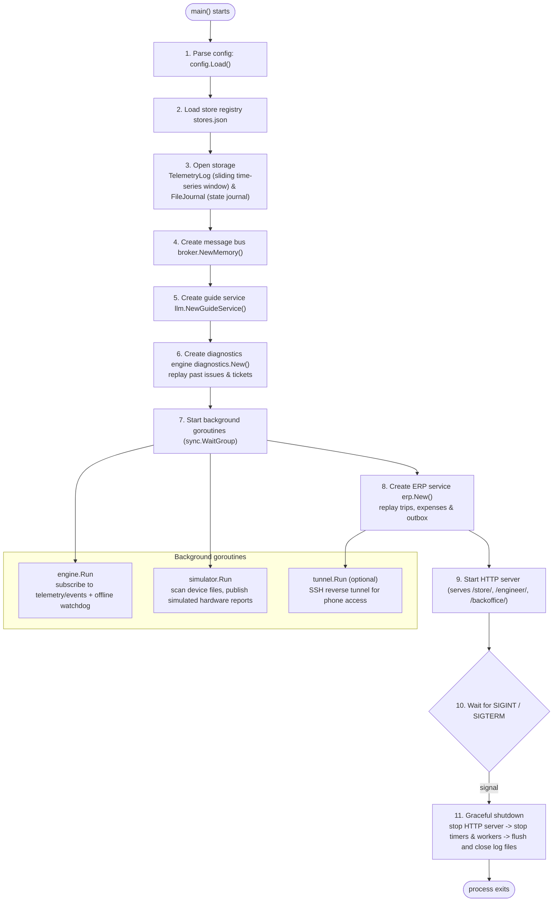
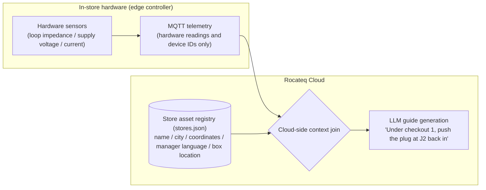
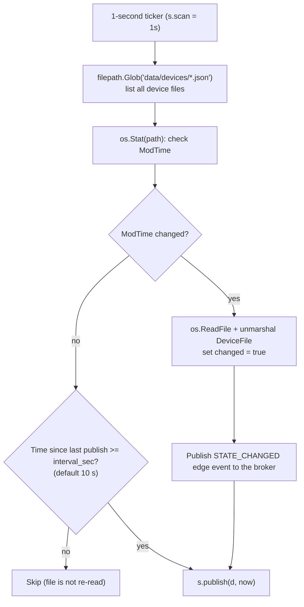
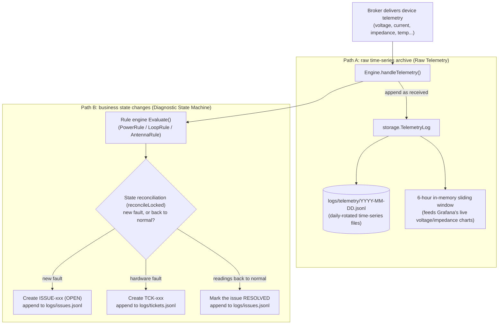
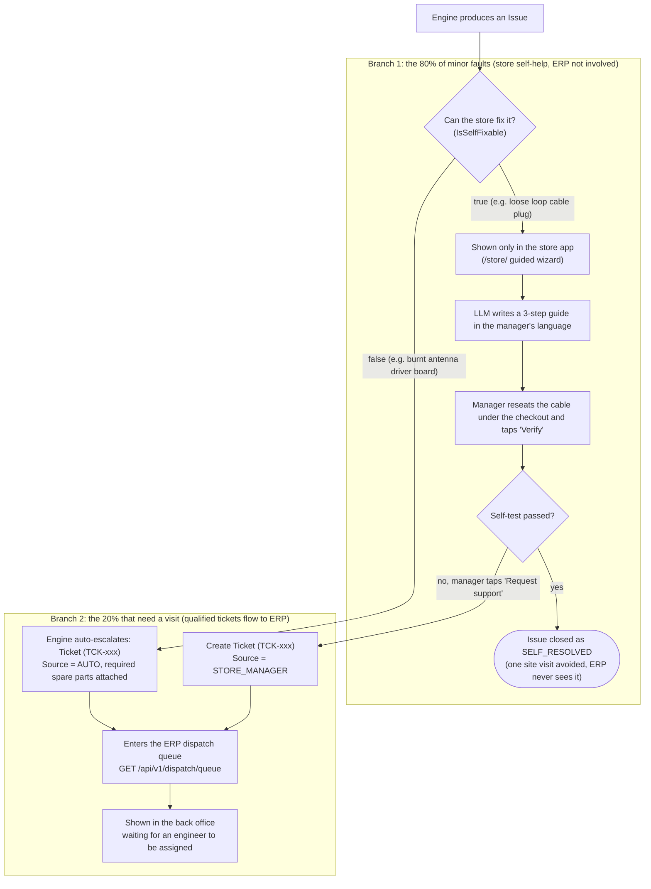
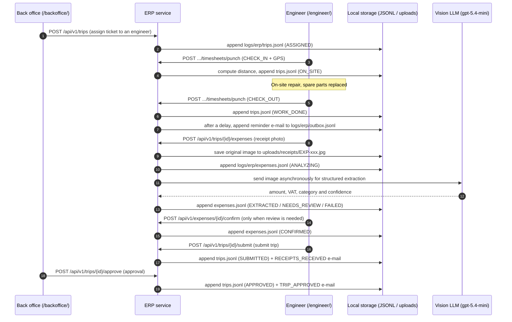

# Rocateq System Workflow & Design Manual

> **Version**: v1.1.0 | **Date**: 2026-10-12  
> **Audience**: backend developers, system architects, after-sales operations and business management  
> **Entry point**: [`cmd/rocadash/main.go`](../cmd/rocadash/main.go) | **Related**: [`technical_architecture_spec.md`](technical_architecture_spec.md) · Chinese edition: [`system_workflow_design_manual.md`](system_workflow_design_manual.md)

---

## Contents
1. [Process lifecycle and assembly (main.go)](#1-process-lifecycle-and-assembly-maingo)
2. [Pipeline A: remote diagnostics and store self-help (Dashboard)](#2-pipeline-a-remote-diagnostics-and-store-self-help-dashboard)
   - 2.1 [Mechanism 1: edge device simulation and ingestion](#21-mechanism-1-edge-device-simulation-and-ingestion)
     - 2.1.1 Device mirror (`devices/*.json`) vs cloud asset registry (`stores.json`)
     - 2.1.2 Single-goroutine, lock-free simulator and in-place `*device` mutation
     - 2.1.3 Sensor jitter and byte-only broker isolation
   - 2.2 [Mechanism 2: dual-path split of time-series facts and business state](#22-mechanism-2-dual-path-split-of-time-series-facts-and-business-state)
     - 2.2.1 Storage locations and record formats
     - 2.2.2 How Grafana really talks to the backend
   - 2.3 [Mechanism 3: Issue vs Ticket admission control (the core dispatch filter)](#23-mechanism-3-issue-vs-ticket-admission-control-the-core-dispatch-filter)
     - 2.3.1 80% store self-help loop vs 20% ERP dispatch admission
     - 2.3.2 Interface isolation: why ERP never touches `Issues`
   - 2.4 [Worked example: Jumbo store fixes its own loop cable](#24-worked-example-jumbo-store-fixes-its-own-loop-cable)
3. [Pipeline B: engineer trips, timesheets and AI expense claims (ERP)](#3-pipeline-b-engineer-trips-timesheets-and-ai-expense-claims-erp)
   - 3.1 [Event and request flow](#31-event-and-request-flow)
   - 3.2 [Storage locations and record formats](#32-storage-locations-and-record-formats)
   - 3.3 [Worked example: antenna replacement and travel claim at REWE Berlin](#33-worked-example-antenna-replacement-and-travel-claim-at-rewe-berlin)

---

## 1. Process lifecycle and assembly (main.go)

Everything starts in [`cmd/rocadash/main.go`](../cmd/rocadash/main.go). The system is a **single-process modular monolith**: device simulation, message ingestion, rule-based diagnostics, LLM guide generation and the ERP trip/expense workflow all run in one Go binary with a very small footprint. Modules talk to each other only through interfaces, so each one can later be swapped for its production counterpart (EMQX, TimescaleDB, …).



### Assembly steps in detail
1. **Configuration** ([`config.Load`](../internal/config/config.go#L43)): precedence is **command-line flag > environment variable > `.env` file > built-in default**. The `.env` file only fills in variables that are not already set in the real environment.
2. **Time-series and state storage**:
   - [`storage.NewTelemetryLog`](../internal/storage/telemetry.go#L37): manages the daily-rotated JSONL files under `logs/telemetry/` and, on start, preloads the most recent sliding window (default 6 hours) into memory.
   - [`storage.NewFileJournal`](../internal/storage/journal.go#L31): manages the issue, ticket and device-event journals under `logs/`.
3. **Message bus** ([`broker.NewMemory`](../internal/broker/memory.go#L30)): MQTT-style topics with `+`/`#` wildcard subscriptions, decoupling data collection from diagnostics.
4. **Engine state rebuild** ([`diagnostics.New`](../internal/diagnostics/engine.go#L67)): creates one state machine per controller and calls `restore()` to replay the issue and ticket journals; still-open issues are re-attached to their controllers.
5. **Background goroutines**: `engine.Run` subscribes first; the simulator starts 100 ms later so the engine does not miss the first heartbeat burst.
6. **ERP wiring and recovery** ([`erp.New`](../internal/erp/service.go#L67)): connects to the engine through the read-only [`TicketSource`](../internal/erp/service.go#L29-L33) interface; restores trips, expenses and e-mails from `logs/erp/` and re-arms pending reminder timers.
7. **HTTP and static front-ends** ([`api.New`](../internal/api/server.go#L40)): standard-library router serving `/store/` (store manager), `/engineer/` (engineer phone app), `/backoffice/` (back office) and the JSON feeds consumed by Grafana's Infinity datasource.

---

## 2. Pipeline A: remote diagnostics and store self-help (Dashboard)

**Business goal**: use sensor telemetry plus LLM-generated guides in the manager's own language so that store managers fix about 80% of minor faults themselves (a loose plug, a tripped power adapter), **stopping unnecessary site visits before they are booked**.

---

### 2.1 Mechanism 1: edge device simulation and ingestion

#### 2.1.1 Device mirror (`devices/*.json`) vs cloud asset registry (`stores.json`)
The data model keeps two kinds of data strictly apart:



* **`data/devices/*.json` (device mirror)**:
  * **In production**: the physical **Rocateq controller** installed under a checkout. Its sensors continuously measure loop impedance, supply voltage and similar physical values.
  * **In the demo**: **one JSON file = one physical controller**. Editing a value in the file (e.g. setting an impedance to `99999`) is the demo equivalent of pulling a cable out in the store.
* **`data/stores.json` (cloud-side store asset registry)**:
  * **It is never reported by the hardware.** A controller only knows its own ID. It does not know which supermarket it belongs to, whether the manager speaks Dutch or French, or whether it sits "under checkout 1" or "behind the customer service desk".
  * It is the **business topology record** that operations staff enter in the cloud at contract signing and site survey time.
  * **Why it matters**: it is the business context that lets the LLM turn a cold error code into precise, plain-language instructions for a non-technical manager.

#### 2.1.2 Single-goroutine, lock-free simulator and in-place `*device` mutation
Implementation: [`internal/simulator/simulator.go`](../internal/simulator/simulator.go).



1. **Why `map[string]*device` holds pointers**:
   * The simulator stores `devices map[string]*device`.
   * **Why a pointer and not a value?**
     - With a value map (`map[string]device`), `d := s.devices[path]` returns a copy. Changing `d.file` does not touch the map entry unless it is written back explicitly, and Go does not even allow `s.devices[path].file = f`.
     - More subtly, the heartbeat bookkeeping in `publish()` (`d.lastPublish = now`) would only update the copy. The timestamp would never reach the map and the device would re-publish every second.
     - **With `*device` the object is mutated in place**: when a file changes, the heap object is updated directly with no copying.
2. **Single-goroutine, lock-free design**:
   * The field is documented as `devices map[string]*device // by path; only touched by the Run goroutine`.
   * File scanning, in-memory updates, heartbeats and answers to cloud `SELF_TEST` commands **all run serially in the same `select` loop of `Run()`**, so no mutex is needed. It is both fast and race-free.
3. **Two publish triggers**:
   * **Report on change (no wait)**: as soon as a file is modified (`changed == true`), memory is updated and telemetry is published on the next 1-second scan.
   * **Periodic heartbeat (keep-alive)**: when the file is unchanged, `now.Sub(d.lastPublish) >= interval` triggers a heartbeat, every 10 seconds by default.
   * A device with `"sim": {"online": false}` stays silent, which the engine's watchdog turns into `GATEWAY_OFFLINE` after `OFFLINE_TIMEOUT` (default 30 s).

#### 2.1.3 Sensor jitter and byte-only broker isolation
* **Simulated sensor noise**: [`withJitter()`](../internal/simulator/simulator.go#L192) adds small random noise to voltage (±50 mV), current (±10 mA), temperature (±0.3 °C) and impedance (±1 Ω, only for impedances below 1 kΩ, so an open circuit stays open). Dashboard charts then move like real sensor readings without changing any diagnostic outcome.
* **The broker only sees bytes**:
  * `publish` serialises the payload with `b, _ := json.Marshal(t)` and hands the `[]byte` to the broker.
  * **The broker never reads disk files and does not know they exist.** It only routes byte slices by topic, exactly like an EMQX cluster in production.

---

### 2.2 Mechanism 2: dual-path split of time-series facts and business state

For every telemetry packet the broker delivers, the diagnostics engine immediately splits the data into two independent paths:



#### 2.2.1 Storage locations and record formats

All journals are append-only. Every line is a full snapshot of the entity, so replay simply keeps the **last line per ID**.

| Data | File | Written when | Format and key fields |
| :--- | :--- | :--- | :--- |
| **Telemetry** | `logs/telemetry/YYYY-MM-DD.jsonl` | Every valid telemetry packet | `{"received_at": "...", "telemetry": { "power": {...}, "peripherals": {...} }}` |
| **Issue journal** | `logs/issues.jsonl` | Issue opened, verify attempt, escalated, resolved | `{"at": "...", "event": "opened\|verify_attempt\|escalated\|resolved", "issue": {...}}` |
| **Tickets** | `logs/tickets.jsonl` | Auto-escalation of a hardware fault, manual escalation by the manager, ticket closed | `{"ticket_id": "...", "store_id": "...", "code": "...", "source": "AUTO\|STORE_MANAGER", "status": "OPEN\|CLOSED", "snapshot": [...]}` |
| **Device events** | `logs/device_events.jsonl` | Edge events from a controller (e.g. `STATE_CHANGED` when its device file was edited) | `{"store_id": "...", "controller_id": "...", "timestamp": 0, "type": "STATE_CHANGED", "detail": "..."}` |

#### 2.2.2 How Grafana really talks to the backend
* **Common misconception**: **Grafana does not read `issues.jsonl` or the telemetry files on disk.**
* **How it actually works**:
  * Grafana uses the **Infinity plugin** to call the backend REST API over HTTP (`GET /api/v1/ops/summary`, `/ops/stores`, `/ops/issues?state=open`, `/ops/tickets`, `/ops/telemetry`, `/ops/erp/*`).
  * The `.jsonl` files on disk are a **WAL / journal** used only to restore state after a crash or restart.
  * At runtime the API reads **only the engine's in-memory state machines and the 6-hour sliding window**, aggregates in about a millisecond and returns the result to Grafana. Reads never hit the disk.
* **What the top-row stat tiles count**: `/ops/summary` counts **stores, not issues**. Each store takes the most severe status among its controllers (`OFFLINE > SERVICE_REQUIRED > ESCALATED > ACTION_REQUIRED > UNKNOWN > HEALTHY`). "Technician requested" is the number of stores whose worst status is `ESCALATED`, meaning a ticket is open. It does not mean an ERP trip has been created.

---

### 2.3 Mechanism 3: Issue vs Ticket admission control (the core dispatch filter)

This is the **strategic core** of the system. It strictly separates an **`Issue` (an observed fault)** from a **`Ticket` (a qualified dispatch request)**:



#### 2.3.1 80% store self-help loop vs 20% ERP dispatch admission
* **The 80% of minor faults (`IsSelfFixable: true`)**:
  * For example a loose power plug or a disconnected loop cable. These go to the store app `/store/` only and **do not enter the ERP dispatch queue as long as the manager does not escalate**.
  * The manager follows the wizard on their phone, reseats the cable and taps Verify. The engine sends a `SELF_TEST` command to the controller and waits for fresh telemetry; if it is healthy the issue is closed on the spot. No engineer is involved and a cross-border trip of €1,500–€3,000 is saved.
  * A failed verification does **not** escalate automatically. The issue stays `OPEN` and the manager can retry or tap "Request support".
* **The 20% that need a visit (hardware fault or failed self-help)**:
  * **Auto-escalation**: the rules decide it is a hardware fault (`!IsSelfFixable`, e.g. a burnt driver board) and immediately create a `Ticket` with the required spare parts (`Source = AUTO`).
  * **Manual escalation**: the manager could not fix it and taps "Request support" in the wizard (`POST /api/v1/stores/{store_id}/tickets/escalate`), creating a `Ticket` with `Source = STORE_MANAGER`. A manager can also report a problem when no issue is open; the ticket then carries the code `MANAGER_REPORTED`.
  * **Only faults that became a `Ticket` reach the ERP dispatch queue (`GET /api/v1/dispatch/queue`).**
* **The dispatch queue is not stored anywhere**. ERP computes it on every request: all `OPEN` tickets from the engine minus tickets that already have a trip. Once a ticket is dispatched it leaves the queue, but on the diagnostics side the store remains `ESCALATED` until fresh telemetry shows the fault is gone. The engine then resolves the issue as `RESOLVED_BY_SERVICE` and closes the ticket (`status: CLOSED`).

#### 2.3.2 Interface isolation: why ERP never touches `Issues`
[`internal/erp/service.go`](../internal/erp/service.go#L29-L33) defines a strict read-only contract:

```go
// TicketSource is what ERP needs from the diagnostics engine.
type TicketSource interface {
    Tickets() []model.Ticket // ERP sees dispatch tickets only, never the raw Issues collection
    Store(storeID string) (diagnostics.StoreView, bool)
}
```

The type system cuts ERP off from `Issue` entirely, and ERP never writes anything back to the engine. This dependency inversion keeps the boundary clear: **the diagnostics engine decides what deserves a visit; ERP only ever handles tickets that really need an engineer**.

---

### 2.4 Worked example: Jumbo store fixes its own loop cable

* **Data involved**:
  - Store: `NL-JUMBO-1042` (Jumbo Rotterdam Centrum, Netherlands, language `nl`)
  - Controller: `CTRL-UNIT-01`, location `onder kassa 1` (under checkout 1)
  - Initial file: [`data/devices/NL-JUMBO-1042_CTRL-UNIT-01.json`](../data/devices/NL-JUMBO-1042_CTRL-UNIT-01.json)
* **How it unfolds**:
  1. **Fault detected**: the device reports an abnormal loop impedance:
     ```json
     "perimeter_loop_1": { "port": "J2", "impedance_ohms": 99999, "status": "OPEN_CIRCUIT", "signal_tx_active": false }
     ```
  2. **Journaled**: `logs/issues.jsonl` gets an issue record (state `OPEN`, `is_self_fixable: true`):
     ```json
     {"at":"2026-10-12T12:35:16Z","event":"opened","issue":{"issue_id":"ISSUE-20261012-0003","store_id":"NL-JUMBO-1042","controller_id":"CTRL-UNIT-01","finding":{"code":"LOOP_CABLE_DISCONNECTED","severity":"HIGH","target_module":"perimeter_loop_1 connector J2","target_port":"J2","is_self_fixable":true},"state":"OPEN"}}
     ```
  3. **Manager opens the wizard**: at `/store/` the LLM produces a 3-step guide in Dutch. The exact wording varies per call; a typical result:
     - *Stap 1*: Open the Rocateq control box under checkout 1.
     - *Stap 2*: Find the cable plug at port J2 and push it firmly back in until it clicks.
     - *Stap 3*: Tap "Opnieuw testen" (test again).
  4. **Loop closed**: the manager reseats the cable and taps Verify. The device reports a normal impedance (about 5 Ω), and the issue becomes `RESOLVED` with resolution `SELF_RESOLVED`. **Nothing appears in the ERP dispatch queue and the site visit is avoided.**

---

## 3. Pipeline B: engineer trips, timesheets and AI expense claims (ERP)

**Business goal**: handle the 20% of hardware faults that do need an engineer on site. GPS-tagged check-in/check-out gives accurate working hours, and a vision LLM turns receipt photos into structured expense lines within seconds.

### 3.1 Event and request flow



1. **Dispatch and time tracking**:
   - The back office assigns an open ticket to an engineer with `POST /api/v1/trips`, creating a trip `TRIP-<year>-<CITY>-NNNN`.
   - On arrival the engineer calls `POST /api/v1/engineers/timesheets/punch` with `CHECK_IN`, and with `CHECK_OUT` on leaving.
   - Working hours always use **server time** (the client clock is kept for audit only). The GPS position is compared with the store using the Haversine formula; punches more than **1 km** away are counted as `geo_warnings` in the trip summary for audit.
2. **Reminder and receipt extraction**:
   - After check-out the system waits `REMINDER_DELAY` (20 s in the demo; an evening cron job in production) and writes a `RECEIPT_REMINDER` e-mail to the outbox, but only if the trip has not been submitted yet.
   - The engineer uploads photos with `POST /api/v1/trips/{trip_id}/expenses`. The original image is stored first and the vision LLM is then called asynchronously.
   - The model extracts merchant, date, time, currency, VAT, total and category (`HOTEL`, `TRANSPORT_FLIGHT_TRAIN`, `TAXI`, `MEAL`, `TOOLS_SUPPLIES`, `OTHER`). With confidence ≥ 0.8 and no manual-review flag the result is accepted automatically (`EXTRACTED`); otherwise it becomes `NEEDS_REVIEW`. If the LLM is unavailable the expense becomes `FAILED` and is entered by hand. `NEEDS_REVIEW` / `FAILED` receipts must be confirmed or corrected by the engineer (`CONFIRMED`) before approval. The raw model output is never edited, so the audit trail always shows what the LLM read and what the engineer approved.
3. **Submit and approve**:
   - After check-out the engineer submits the trip: `POST /api/v1/trips/{trip_id}/submit`.
   - The approver gives final sign-off in the back office: `POST /api/v1/trips/{trip_id}/approve`. Receipts still awaiting review block approval.

### 3.2 Storage locations and record formats

Like the diagnostics journals, these files are append-only snapshot logs: a status change appends a new full snapshot, and replay keeps the last line per ID.

| Data | File | Written when | Format and key fields |
| :--- | :--- | :--- | :--- |
| **Trips and timesheets** | `logs/erp/trips.jsonl` | Dispatch, every punch, submit, approve | `{"trip_id": "...", "status": "...", "punches": [{"action": "...", "at": "...", "distance_to_store_km": 0.02}]}` |
| **Expense lines** | `logs/erp/expenses.jsonl` | Upload, LLM extraction finished, engineer confirmation | `{"expense_id": "...", "status": "...", "extracted": {...}, "final": {...}, "model": "gpt-5.4-mini"}` |
| **Original receipt images** | `uploads/receipts/{expense_id}.{ext}` | Photo uploaded from the engineer app | Original image file (max 10 MB) |
| **Outbox e-mails** | `logs/erp/outbox.jsonl` | Receipt reminder, submission receipt, approval notice | `{"email_id": "...", "kind": "RECEIPT_REMINDER\|RECEIPTS_RECEIVED\|TRIP_APPROVED", "to": "...", "subject": "...", "body": "..."}` |

### 3.3 Worked example: antenna replacement and travel claim at REWE Berlin

* **Data involved**:
  - Store: `DE-REWE-3301` (REWE Berlin Mitte, Germany, coordinates 52.5200, 13.4050)
  - Ticket: `TCK-20261012-0001` (code `ANTENNA_TX_FAULT`, spare parts `ANT-DRV-BOARD-V3`, `COAX-RG58-2M`)
  - Engineer: Mark de Boer (`ENG-MARK-01`, based in Rotterdam)
  - Sample receipt: [`data/sample_receipts/03_taxi_berlin.jpg`](../data/sample_receipts/03_taxi_berlin.jpg)
* **How it unfolds**:
  1. **Dispatch**: the back office assigns the Berlin ticket and `logs/erp/trips.jsonl` records:
     ```json
     {"trip_id":"TRIP-2026-BERLIN-0001","ticket_id":"TCK-20261012-0001","store_id":"DE-REWE-3301","city":"Berlin","engineer_id":"ENG-MARK-01","status":"ASSIGNED","code":"ANTENNA_TX_FAULT","required_parts":["ANT-DRV-BOARD-V3","COAX-RG58-2M"]}
     ```
  2. **Check-in on site**: Mark arrives in Berlin with the parts and checks in on his phone; the punch is stored in `trips.jsonl`:
     ```json
     {"action":"CHECK_IN","at":"2026-10-12T13:00:00Z","geo":{"lat":52.5201,"lng":13.4051},"distance_to_store_km":0.02}
     ```
  3. **Repair and check-out**: after replacing the antenna driver board and confirming the fault is gone, Mark checks out (`CHECK_OUT`, 2.5 hours on site). Twenty seconds later the reminder e-mail is written to `logs/erp/outbox.jsonl`:
     ```json
     {"email_id":"MAIL-20261012-0001","kind":"RECEIPT_REMINDER","trip_id":"TRIP-2026-BERLIN-0001","to":"mark.deboer@rocateq.example","subject":"[TRIP-2026-BERLIN-0001] Expense reminder — your trip to Berlin"}
     ```
  4. **Receipt photo parsed**: Mark photographs his Berlin taxi receipt; the image is stored as `uploads/receipts/EXP-20261012-0001.jpg`. The vision model's result is written to `logs/erp/expenses.jsonl`:
     ```json
     {
       "expense_id": "EXP-20261012-0001",
       "trip_id": "TRIP-2026-BERLIN-0001",
       "status": "EXTRACTED",
       "extracted": {
         "merchant_name": "Taxi Funk Berlin",
         "transaction_date": "2026-10-12",
         "currency": "EUR",
         "total_amount": 34.50,
         "vat_amount": 2.26,
         "expense_category": "TAXI",
         "confidence_score": 0.96,
         "flag_manual_review": false,
         "line_items_summary": "Taxi ride Berlin Hauptbahnhof to REWE Mitte"
       }
     }
     ```
  5. **Approval and archive**: Mark checks the figures and submits; a manager approves the trip in `/backoffice/`, closing the loop.
